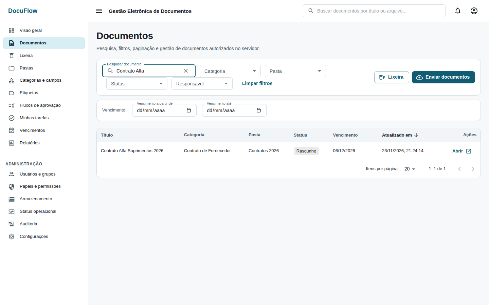
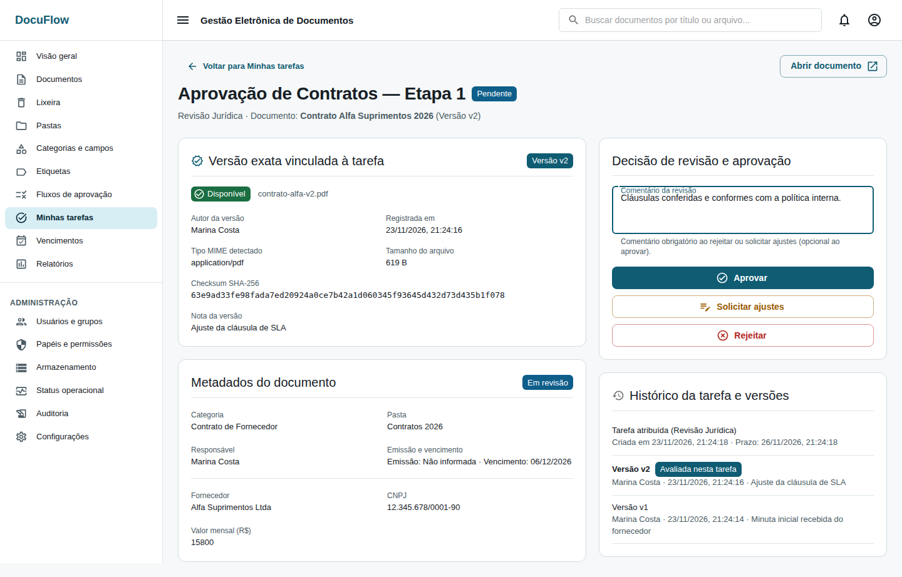
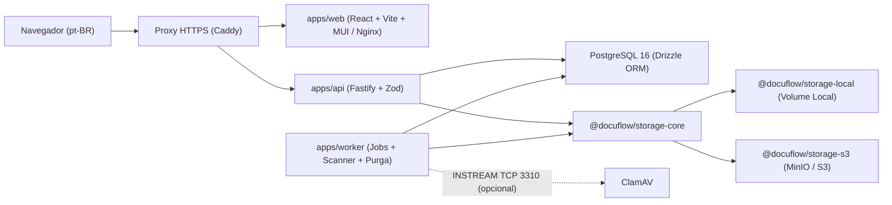

# DocuFlow

**Gerenciador Eletrônico de Documentos (GED) *self-hosted* orientado a governança, segurança documental e rastreabilidade ponta a ponta.**

[](./CHANGELOG.md)
[](https://github.com/vieirafabiog/DocuFlow/actions/workflows/ci.yml)
[](./package.json)
[](./tsconfig.base.json)
[](./infra/compose/docker-compose.yml)
[](./infra/compose/docker-compose.yml)

O **DocuFlow** centraliza arquivos corporativos na própria infraestrutura da organização, combinando metadados tipados, versões imutáveis (*append-only*), controle de acesso aplicado no servidor, quarentena e verificação antimalware em streaming, fluxos sequenciais de revisão/aprovação, monitoramento de vencimentos, retenção com *legal hold*, auditoria imutável e armazenamento desacoplado (filesystem local ou S3 compatível).

[Funcionalidades](#-principais-funcionalidades) •
[Interface](#-visão-geral-da-interface) •
[Arquitetura](#-arquitetura-e-estrutura-do-monorepo) •
[Implantação Self-Hosted](#-implantação-self-hosted-docker-compose) •
[Desenvolvimento & Testes](#-desenvolvimento-local-e-qualidade) •
[Documentação](#-documentação-completa)

---

## ✨ Principais Funcionalidades

### 📁 Gestão Documental, Metadados e Versões Imutáveis
- **Organização estruturada:** árvore hierárquica de pastas com herança de escopo, etiquetas transversais e categorias documentais configuráveis.
- **Metadados tipados validados no servidor:** suporte a `TEXT`, `NUMBER`, `DATE`, `BOOLEAN`, `SINGLE_SELECT` e `MULTI_SELECT`, com datas de emissão e vencimento.
- **Versionamento *append-only*:** novas revisões nunca sobrescrevem arquivos anteriores; cada versão preserva autor, data, observação e checksum SHA-256, com restauração não destrutiva (gerando nova versão vigente).
- **Busca e pré-visualização seguras:** pesquisa global, filtros combinados, ordenação e paginação executados no PostgreSQL respeitando as permissões do usuário antes da contagem; pré-visualização inline privada de PDFs e imagens sem URLs públicas permanentes.

### 🔒 Segurança Documental, Acesso e Governança
- **Autenticação e sessão protegidas:** senhas com `Argon2id`, sessões server-side com rotação automática (`HttpOnly`, `SameSite=Lax`, `Secure` em produção), proteção CSRF (*double-submit* com comparação em tempo constante), CORS por allowlist e rate limit de login.
- **Autorização granular no servidor:** verificação `action + resource + scope` (`GLOBAL`, `CATEGORY`, `FOLDER`, `DOCUMENT`) com negação por omissão, herança hierárquica e precedência **`DENY > ALLOW`**.
- **Pipeline de upload seguro em streaming:** geração de chaves opacas sem nome original nem PII (`org/{organizationId}/documents/{documentId}/versions/{versionId}/{objectId}`), validação de tamanho máximo, inspeção de MIME real por assinatura binária, conferência SHA-256, quarentena obrigatória e integração ClamAV (`INSTREAM`) em **falha fechada**.
- **Retenção, lixeira e auditoria:** políticas configuráveis por categoria, bloqueio de descarte por *legal hold*, lixeira documental com janela de restauração, expurgo físico idempotente (`DELETE_PENDING`) e tabela `audit_events` *append-only* livre de segredos, tokens ou conteúdo binário.

### ✅ Fluxos de Aprovação e Controle de Vencimentos
- **Aprovação humana sequencial:** envio de documentos para fluxos com etapas ordenadas vinculados de forma imutável à versão exata (`document_version_id`).
- **Decisões rastreáveis (`Minhas tarefas`):** aprovar, rejeitar ou solicitar ajustes (com comentário obrigatório), preservando histórico por rodada e por versão.
- **Vencimentos e alertas internos:** classificação automática (*Vencidos*, *Próximos*, *Sem data*, *Em dia*) usando o fuso horário da organização, janelas configuráveis (`7` a `90` dias) e notificações internas.

### 🗄️ Armazenamento Desacoplado e Cofre de Segredos
- **Adaptadores com paridade de contrato (`@docuflow/storage-core`):**
  - **Filesystem Local (`@docuflow/storage-local`):** escrita atômica, proteção contra *path traversal* e bloqueio de symlinks.
  - **S3 Compatível (`@docuflow/storage-s3`):** AWS SDK v3 isolado, validação anti-SSRF (bloqueio de metadados cloud e IPs privados), suporte a URLs temporárias assinadas de TTL curto e contrato comprovado contra **MinIO**.
- **Roteamento por categoria e proteção de credenciais:** conexão padrão e regras por categoria; credenciais S3 e SMTP cifradas com **AES-256-GCM** usando chave mestra externa (`ENCRYPTION_KEY` / `ENCRYPTION_KEYRING`), jamais retornadas à interface ou gravadas em logs.

> **Escopo transparente da `1.0.0-rc.1`:** esta versão foca em implantação self-hosted de organização única. Recursos pós-MVP como **SaaS multi-tenant**, **OCR**, **OIDC/LDAP/MFA**, **Azure Blob / Google Cloud Storage**, **migração automática entre storages** e **assinatura eletrônica** permanecem explicitamente fora do escopo. Consulte também as notas operacionais em [Limitações Conhecidas](./docs/known-limitations.md).

---

## 🖥️ Visão Geral da Interface

Interface empresarial em português do Brasil (`pt-BR`) construída com React e Material UI (`@mui/material`), utilizando tema próprio (`@docuflow/ui`) inspirado nos tokens e padrões do Material Design 3, com foco em legibilidade tabular, filtros visíveis e acessibilidade WCAG 2.2 AA.

| Acervo Documental, Busca e Filtros | Revisão e Aprovação Vinculada à Versão |
| :---: | :---: |
|  |  |

Veja o passo a passo completo com todas as capturas atualizadas (login, pastas, categorias, upload, metadados, versões, aprovação, vencimentos e lixeira) no [Manual do Usuário](./docs/user-guide.md).

---

## 🏗️ Arquitetura e Estrutura do Monorepo

O sistema adota arquitetura de **monólito modular** em `pnpm workspaces` com fronteiras estritas entre domínio, contratos, persistência, adaptadores de storage e interfaces de entrada:



### Mapa do Monorepo

| Pacote / App | Responsabilidade |
| --- | --- |
| [`apps/web`](./apps/web) | Aplicação SPA em React 19 + Vite + MUI 7 (`pt-BR`), servida em container Nginx não-root |
| [`apps/api`](./apps/api) | Servidor HTTP Fastify 5; compõe módulos, autentica, autoriza e orquestra casos de uso |
| [`apps/worker`](./apps/worker) | Processamento assíncrono: verificação de upload/antivírus, expiração, integridade e expurgo físico |
| [`packages/contracts`](./packages/contracts) | Schemas Zod compartilhados e contratos HTTP públicos |
| [`packages/domain`](./packages/domain) | Entidades, máquinas de estado, regras de negócio e portas (sem dependência de framework/SDK) |
| [`packages/auth`](./packages/auth) | Hash `Argon2id`, gerenciamento de sessões, catálogo de papéis e motor de autorização |
| [`packages/database`](./packages/database) | Schema Drizzle ORM, migrations SQL (`0000`–`0003`), repositórios e executor seguro com advisory lock |
| [`packages/storage-core`](./packages/storage-core) | Contrato `StorageProvider`, registry, capabilities, cofre AES-256-GCM e normalização de erros |
| [`packages/storage-local`](./packages/storage-local) | Implementação de storage em filesystem local com escrita atômica e validação de caminhos |
| [`packages/storage-s3`](./packages/storage-s3) | Implementação S3 compatível isolando AWS SDK v3, proteção SSRF e URLs pré-assinadas |
| [`packages/file-processing`](./packages/file-processing) | Validação de MIME por magic bytes, checksum SHA-256 em stream e adaptador ClamAV |
| [`packages/notifications`](./packages/notifications) | Abstração de notificações internas e entrega SMTP |
| [`packages/config`](./packages/config) | Validação tipada de configuração e políticas de upload/extensões |
| [`packages/ui`](./packages/ui) | Biblioteca de tema (inspirado em MD3) e componentes reutilizáveis (`DataTable`, `FilterBar`, estados) |

### Stack Tecnológica

- **Runtime e Linguagem:** Node.js `>=22`, TypeScript `5.8` (`strict`, `noUncheckedIndexedAccess`, `exactOptionalPropertyTypes`), `pnpm 12.21.0`
- **Backend e Dados:** Fastify 5, Zod, PostgreSQL `16.8`, Drizzle ORM `0.45.4`, Argon2id
- **Frontend:** React 19, Vite 7, TanStack Query, React Router, Material UI 7 (`@mui/material`)
- **Storage e Segurança:** AWS SDK S3 v3 (isolado em `storage-s3`), ClamAV (`INSTREAM`), AES-256-GCM
- **Qualidade e Verificação:** Biome, Vitest, Playwright, Testcontainers
- **Empacotamento Self-Hosted:** Docker Compose v2 com imagens base fixadas, containers não-root e Caddy `2.9.1`

---

## 🚀 Implantação Self-Hosted (Docker Compose)

> Para o passo a passo detalhado (permissões de volume, DNS/TLS com Caddy, criação do primeiro administrador e perfil opcional com MinIO/ClamAV), consulte o **[Guia de Instalação](./docs/installation.md)**.

### Pré-requisitos
- Servidor Linux (`x86_64` ou `arm64`) com **Docker Engine `>= 24`**, **Docker Compose v2**, **OpenSSL** e **Git**
- Portas `80/tcp` e `443/tcp` terminadas no proxy HTTPS ([`infra/caddy/Caddyfile`](./infra/caddy/Caddyfile)); banco `postgres` e serviços internos permanecem isolados em `docuflow_internal`

### Início rápido com imagens fixadas (`1.0.0-rc.1`)

```bash
# 1. Clonar o repositório na versão candidata
git clone https://github.com/vieirafabiog/DocuFlow.git /opt/docuflow
cd /opt/docuflow
git checkout v1.0.0-rc.1

# 2. Preparar variáveis de ambiente com permissão restrita e segredos exclusivos
cp .env.example .env
chmod 600 .env
openssl rand -hex 32  # definir em SESSION_SECRET
openssl rand -hex 32  # definir em ENCRYPTION_KEY (guardar cópia em cofre externo)
openssl rand -hex 24  # definir em POSTGRES_PASSWORD e DATABASE_URL

# 3. Validar configuração Compose, construir imagens fixadas e iniciar o PostgreSQL
docker compose --env-file .env -f infra/compose/docker-compose.yml config >/dev/null
docker compose --env-file .env -f infra/compose/docker-compose.yml build api worker web
docker compose --env-file .env -f infra/compose/docker-compose.yml up -d postgres

# 4. Executar migrations SQL com advisory lock diretamente da imagem da API
docker compose --env-file .env -f infra/compose/docker-compose.yml \
  run --rm --no-deps api sh /app/scripts/maintenance/migrate-entrypoint.sh

# 5. Subir os serviços da aplicação
docker compose --env-file .env -f infra/compose/docker-compose.yml up -d api worker web
```

### Serviços opcionais de laboratório (MinIO e ClamAV)

Para ambientes de laboratório/homologação que não utilizam bucket S3 externo nem scanner ClamAV dedicado:

```bash
docker compose --env-file .env \
  -f infra/compose/docker-compose.yml \
  -f infra/compose/docker-compose.storage.yml \
  --profile lab-storage up -d clamav minio
```

### Backup, Restauração e Atualizações
- **Backup coordenado:** pause o `worker`, execute [`scripts/backup/backup-database.sh`](./scripts/backup/backup-database.sh) e em seguida [`scripts/backup/backup-files.sh`](./scripts/backup/backup-files.sh) (mantendo cópia externa de `.env` / `ENCRYPTION_KEY`). Detalhes em [docs/backup-restore.md](./docs/backup-restore.md).
- **Restauração em ambiente limpo:** execute [`scripts/restore/restore-system.sh`](./scripts/restore/restore-system.sh) com `CONFIRM_RESTORE=YES`, validando checksums SHA-256 e integridade do acervo.
- **Atualização e rollback:** siga o procedimento controlado (backup prévio → parada de `api`/`worker`/`web` → migrations → subida das imagens fixadas) descrito em [docs/operations.md](./docs/operations.md) e [CHANGELOG.md](./CHANGELOG.md).

---

## 💻 Desenvolvimento Local e Qualidade

### Pré-requisitos locais
- **Node.js `>= 22`** e **Corepack** (`pnpm 12.21.0`)
- **Docker** (necessário para Testcontainers nas suítes de integração, operações e E2E)

### Comandos do monorepo

```bash
corepack enable
pnpm install --frozen-lockfile
```

| Comando | Descrição |
| --- | --- |
| `pnpm build` | Compila todos os pacotes TypeScript e o bundle de produção de `apps/web` |
| `pnpm lint` | Executa análise estática e checagem de formatação com Biome |
| `pnpm format` | Aplica formatação automática com Biome |
| `pnpm typecheck` | Valida tipagem estrita (`tsc --noEmit`) em todo o monorepo |
| `pnpm test` | Executa testes unitários, de contrato e de segurança (Vitest) |
| `pnpm test:integration` | Executa testes integrados contra PostgreSQL 16 e MinIO reais (Testcontainers) |
| `pnpm test:operations` | Valida ciclo completo de backup e restauração em ambiente limpo |
| `pnpm test:e2e` | Executa cenários ponta a ponta e acessibilidade no Chromium real (Playwright) |
| `pnpm test:performance` | Executa benchmark reproduzível de login, listagem, busca e uploads concorrentes |
| `pnpm audit:deps` | Audita licenças permissivas e vulnerabilidades em dependências de produção |

---

## 📚 Documentação Completa

### Operação, Uso e Segurança
| Documento | Conteúdo |
| --- | --- |
| [Manual do Usuário (`docs/user-guide.md`)](./docs/user-guide.md) | Guia passo a passo em `pt-BR` com capturas atualizadas de todos os fluxos |
| [Guia de Instalação (`docs/installation.md`)](./docs/installation.md) | Implantação limpa com Docker Compose, volumes, proxy Caddy e bootstrap inicial |
| [Conectores de Armazenamento (`docs/storage-connectors.md`)](./docs/storage-connectors.md) | Filesystem local, S3 compatível / MinIO, permissões IAM, SSRF, health checks e roteamento |
| [Segurança e Permissões (`docs/security.md`)](./docs/security.md) | Papéis, escopos, sessões, cofre AES-256-GCM, quarentena/ClamAV, auditoria e rede |
| [Backup e Restauração (`docs/backup-restore.md`)](./docs/backup-restore.md) | Backup coordenado (DB + arquivos + chave mestra), retenção e restore em ambiente limpo |
| [Manual de Operação (`docs/operations.md`)](./docs/operations.md) | Healthchecks, atualizações seguras, rollback, rotinas periódicas e troubleshooting |

### Release, Qualidade e Referência Técnica
| Documento | Conteúdo |
| --- | --- |
| [Changelog (`CHANGELOG.md`)](./CHANGELOG.md) | Histórico de versões semânticas, migrations incluídas e imagens fixadas |
| [Checklist de Aceitação do MVP (`docs/release-checklist.md`)](./docs/release-checklist.md) | Evidências objetivas das suítes e critérios H.2/H.3 na `1.0.0-rc.1` |
| [Limitações Conhecidas (`docs/known-limitations.md`)](./docs/known-limitations.md) | Itens fora do escopo do MVP 1.0, limitações técnicas e guia de upgrade |
| [Dependências e Licenças (`docs/dependencies-and-licenses.md`)](./docs/dependencies-and-licenses.md) | Inventário de licenças permissivas, auditoria de CVEs e política de manutenção |
| [Proxy Reverso Caddy (`infra/caddy/README.md`)](./infra/caddy/README.md) | Configuração HTTPS/HSTS e alinhamento de limites de upload no proxy |
| [Scripts de Backup (`scripts/backup/README.md`)](./scripts/backup/README.md) | Documentação operacional direta dos scripts de backup |
| [Relatório de Carga (`tests/performance/report.md`)](./tests/performance/report.md) | Metodologia e métricas medidas de login, busca, paginação e uploads concorrentes |
| [Especificação de Produto e Arquitetura (`project.md`)](./project.md) | Documento mestre de domínio, requisitos, segurança e roadmap pós-MVP |
| [Plano de Execução (`EXECUTION_PLAN.md`)](./EXECUTION_PLAN.md) | Trilha completa de entregas (Fases 0 a 17 concluídas) |
| [Diretrizes de Engenharia (`AGENTS.md`)](./AGENTS.md) | Convenções de código, fronteiras do monorepo e requisitos obrigatórios |

---

## 🛡️ Privacidade, Telemetria e Licenciamento

- **Sem telemetria externa:** o DocuFlow não envia métricas, nomes de arquivo, metadados ou logs para servidores externos por padrão.
- **Dependências auditadas:** todas as dependências de runtime utilizam licenças permissivas auditadas automaticamente no CI ([`scripts/ci/check-dependencies.mjs`](./scripts/ci/check-dependencies.mjs)).
