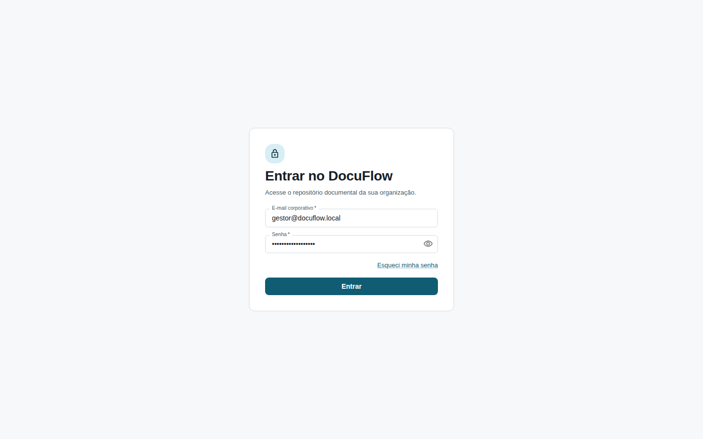
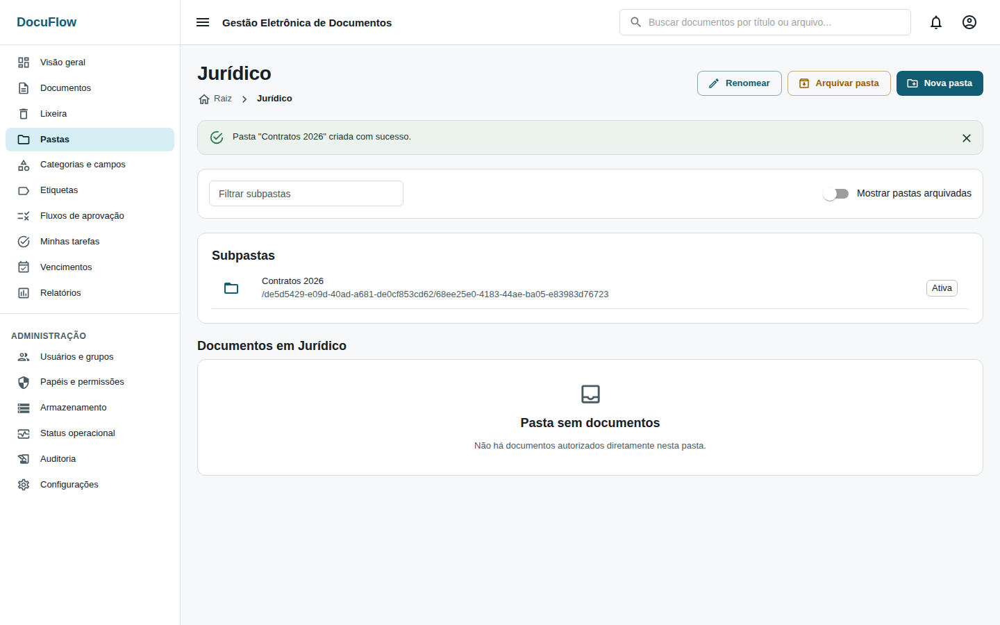
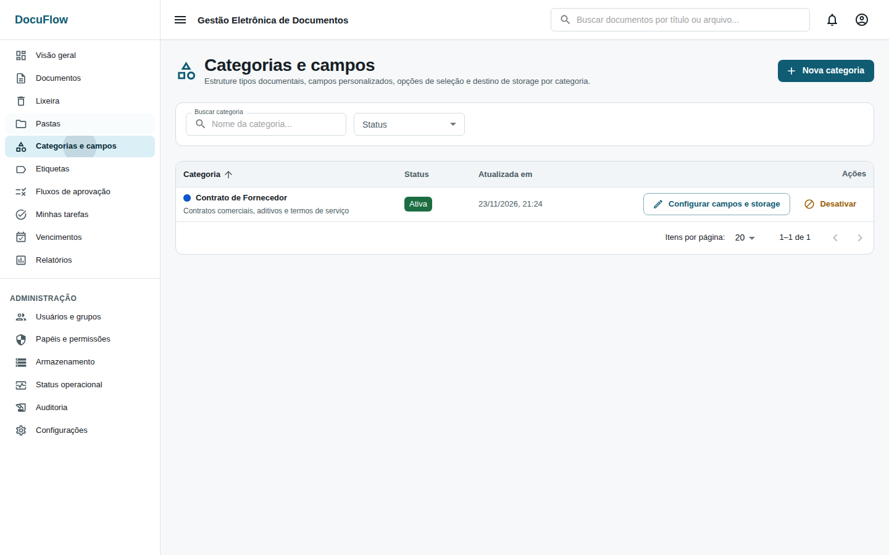
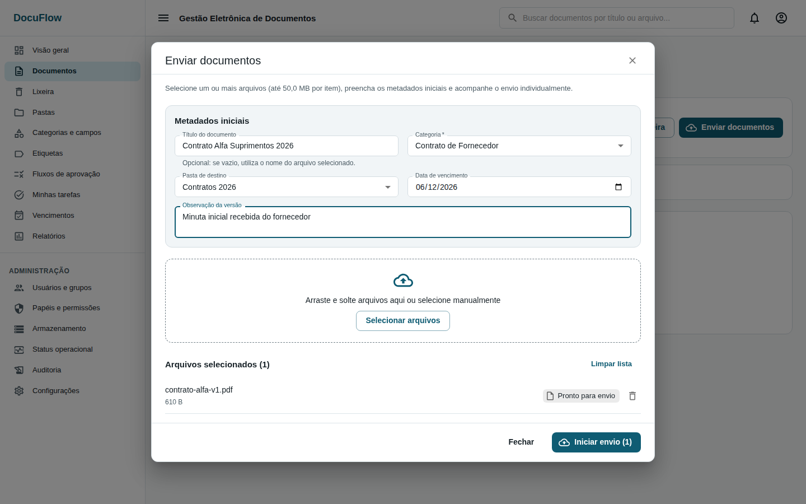
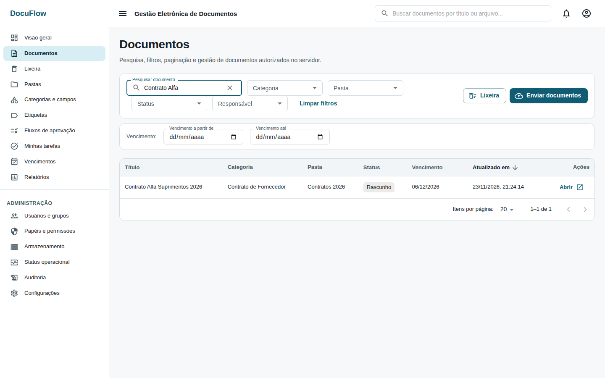
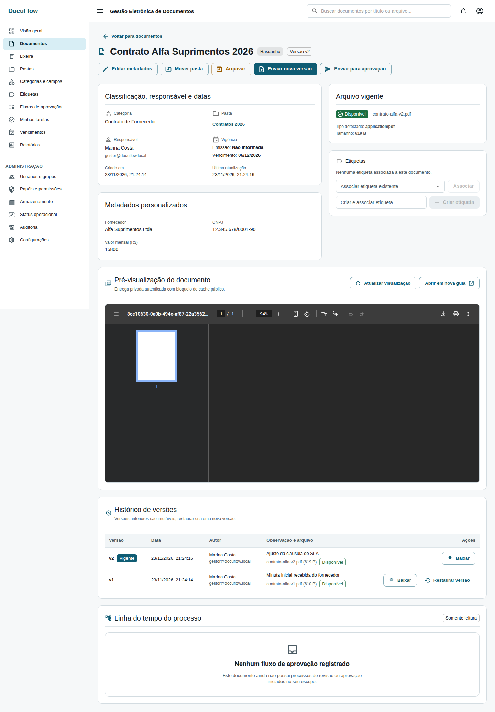
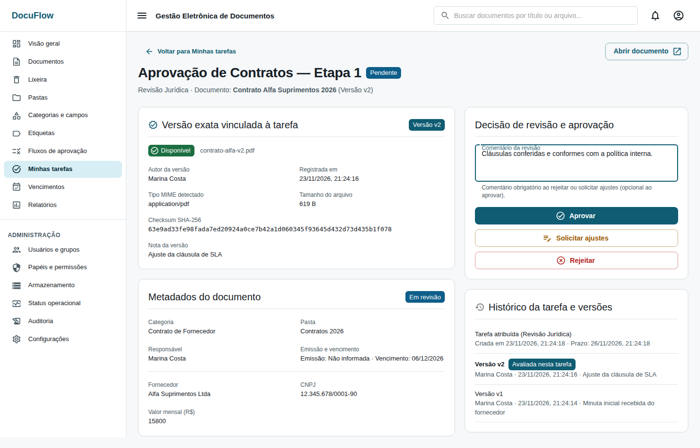
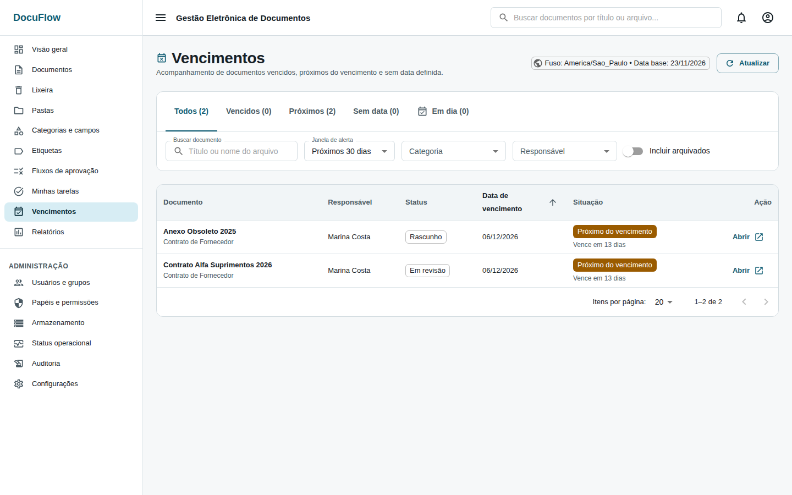

# Manual do Usuário — DocuFlow

Este manual orienta os usuários e gestores do **DocuFlow** nos fluxos principais da versão **1.0 self-hosted**: acesso autenticado, organização em pastas e categorias, envio seguro de arquivos, edição de metadados, controle de versões imutáveis, busca e filtros, revisão e aprovação, acompanhamento de vencimentos e recuperação na lixeira documental.

> Os rótulos de menus, botões e estados descritos abaixo correspondem integralmente à interface em português do Brasil (`pt-BR`) da versão candidata.

---

## 1. Login e Acesso ao Sistema

Acesse o endereço configurado da organização no navegador (por exemplo, `https://ged.suaempresa.com.br`). Caso não exista sessão ativa, você será redirecionado automaticamente para `/login`.

1. Informe seu **E-mail corporativo** e sua **Senha** (mínimo de 10 caracteres conforme política padrão; clique no ícone de olho para exibir ou ocultar os caracteres digitados).
2. Clique em **Entrar**.
3. Caso tenha esquecido sua senha, utilize o link **Esqueci minha senha** (`/recuperar-senha`) para instruções de redefinição junto ao administrador ou fluxo de e-mail configurado.
4. Após autenticação bem-sucedida, o sistema cria uma sessão protegida no servidor (cookie `HttpOnly` e token CSRF automático) e abre a página **Visão geral** (`/`).

### Navegação lateral

- **Área documental:** *Visão geral*, *Documentos*, *Lixeira*, *Pastas*, *Categorias e campos*, *Etiquetas*, *Fluxos de aprovação*, *Minhas tarefas*, *Vencimentos* e *Relatórios*.
- **Administração** (visível conforme papéis e permissões concedidos): *Usuários e grupos*, *Papéis e permissões*, *Armazenamento*, *Status operacional*, *Auditoria* e *Configurações*.

---

## 2. Pastas

O módulo **Pastas** (`/pastas`) organiza documentos em árvore hierárquica com controle de acesso herdado por escopo.

1. Na barra lateral, clique em **Pastas**.
2. Clique em uma pasta listada (por exemplo, `Jurídico`) para abrir o seu conteúdo; utilize a trilha de navegação (*breadcrumb* `Raiz > Jurídico`) para voltar a níveis superiores.
3. Para criar uma subpasta ou pasta raiz, clique em **Nova pasta**, informe o **Nome da pasta** e confirme em **Criar pasta**.
4. Dentro de uma pasta ativa selecionada, usuários autorizados também dispõem das ações **Renomear** e **Arquivar pasta** (pastas arquivadas podem ser exibidas ou ocultadas pelo seletor **Mostrar pastas arquivadas** e utilizam o filtro **Filtrar subpastas**).

---

## 3. Categorias e Campos Personalizados

Em **Categorias e campos** (`/categorias`), usuários com permissão de categoria estruturam os tipos documentais da organização e seus campos tipados.

1. Utilize a barra superior (**Buscar categoria** e filtro **Status**: *Todas*, *Ativas*, *Inativas*) para localizar categorias existentes.
2. Clique em **Nova categoria** para criar um tipo documental ou em **Configurar campos e storage** na linha de uma categoria existente.
3. No editor da categoria, defina nome, descrição, cor identificadora e adicione campos personalizados nos tipos suportados (`Texto`, `Número`, `Data`, `Sim / Não`, `Seleção única` e `Seleção múltipla`), indicando obrigatoriedade e ordem de exibição.
4. Administradores de armazenamento também podem vincular uma regra de roteamento de storage específica para a categoria dentro do mesmo editor.
5. Para suspender o uso de uma categoria sem perder documentos já classificados, utilize **Desativar** (e **Reativar** quando necessário).

> **Observação operacional:** no diálogo de envio inicial (*Enviar documentos*), o registro é criado com os metadados iniciais básicos; caso uma categoria possua campos personalizados marcados como obrigatórios antes da edição detalhada, configure-os como opcionais ou preencha-os na tela de detalhes do documento após o envio.

---

## 4. Envio de Documentos (Upload Seguro)

O envio é feito em streaming seguro com geração de chave opaca no servidor, validação de extensão/MIME real por assinatura binária, verificação de checksum SHA-256 e análise antimalware em segundo plano.

1. Acesse **Documentos** (`/documentos`) e clique em **Enviar documentos**.
2. Preencha os **Metadados iniciais**:
   - **Título do documento** (opcional; se vazio, utiliza o nome do arquivo selecionado ou prefixo em lote);
   - **Categoria** (obrigatória quando houver categorias cadastradas);
   - **Pasta de destino** (opcional; ou *Raiz do acervo*);
   - **Data de vencimento** (opcional);
   - **Observação da versão** (opcional, recomendada para rastreabilidade).
3. Arraste um ou mais arquivos para a área pontilhada ou clique em **Selecionar arquivos**.
4. Confira a fila em **Arquivos selecionados** (status inicial *Pronto para envio*) e clique em **Iniciar envio (N)**.
5. Acompanhe a barra de progresso individual e o estado pós-envio (**Em análise** durante o processamento assíncrono pelo worker até **Disponível**). Caso algum arquivo seja bloqueado pelo scanner ou extensão inválida, o status exibirá **Rejeitado** com mensagem segura, bloqueando preview e download.

---

## 5. Busca e Filtros de Documentos

Todos os filtros, ordenação e paginação de documentos são executados no banco de dados (PostgreSQL) **respeitando estritamente as permissões do usuário autenticado**.

### Busca global no cabeçalho
No topo da aplicação, o campo **Buscar documentos por título ou arquivo...** realiza busca rápida (a partir de 2 caracteres) com acesso direto ao documento selecionado ou tecla `Enter` para abrir a lista filtrada.

### Pesquisa detalhada no acervo (`/documentos`)
1. Utilize **Pesquisar documento** (título ou nome de arquivo) e combine os seletores:
   - **Categoria**;
   - **Pasta**;
   - **Status** (*Rascunho*, *Em revisão*, *Aprovado*, *Rejeitado*, *Arquivado*, *Expirado*);
   - **Responsável**;
   - Faixa de **Vencimento** (*Vencimento a partir de* e *Vencimento até*).
2. Ordene clicando nos cabeçalhos de coluna habilitados (como **Título**, **Status**, **Vencimento** e **Atualizado em**) e ajuste o tamanho de página em **Itens por página**.
3. Clique em **Limpar filtros** para redefinir os critérios ou em **Abrir** para acessar os detalhes do documento.

---

## 6. Metadados, Pré-visualização e Versões

Ao abrir um documento (`/documentos/:id`), a tela apresenta classificação, responsável, datas de vigência, metadados personalizados, etiquetas, arquivo vigente, pré-visualização inline e histórico completo de versões.

### Edição de metadados e etiquetas
1. Clique em **Editar metadados** no topo da página para alterar título, datas de emissão/vencimento e todos os campos personalizados definidos pela categoria (validados no navegador e no servidor). Clique em **Salvar metadados**.
2. No cartão **Etiquetas**, associe etiquetas existentes ou crie e vincule novas etiquetas para classificação transversal.
3. Utilize **Mover pasta** para reorganizar o documento entre pastas ativas autorizadas ou **Arquivar** quando o documento não receberá novas versões.

### Pré-visualização e histórico imutável de versões
- Em **Pré-visualização do documento**, PDFs e imagens aprovados (`Disponível`) são entregues de forma privada por sessão autenticada (sem URL pública permanente). Caso o arquivo ainda esteja `Em análise` ou tenha sido `Rejeitado`, a pré-visualização e o download permanecem bloqueados.
- Para publicar uma nova revisão sem sobrescrever o arquivo anterior, clique em **Enviar nova versão**, informe a **Observação da versão** e envie o novo arquivo.
- A tabela **Histórico de versões** preserva todas as versões em modelo *append-only* (`v1`, `v2`, ...), destacando a versão **Vigente** e oferecendo:
  - **Baixar** (entrega segura por streaming ou URL temporária assinada);
  - **Restaurar versão** em versões anteriores, ação não destrutiva que gera uma **nova versão vigente** apontando para o conteúdo histórico escolhido.

---

## 7. Fluxo de Revisão e Aprovação

Fluxos sequenciais garantem que cada aprovação fique vinculada de forma imutável à versão avaliada (`document_version_id`).

### Iniciar aprovação (Solicitante)
1. Com o documento em *Rascunho* (ou após ajustes/rejeição) e arquivo vigente **Disponível**, abra `/documentos/:id` e clique em **Enviar para aprovação**.
2. Selecione a definição de fluxo (por exemplo, *Aprovação de Contratos*) e confirme em **Confirmar envio**.
3. O status do documento passa para **Em revisão** e o cartão **Linha do tempo do processo** exibe cada etapa, responsável e situação.

### Revisar e decidir tarefas (`Minhas tarefas`)
1. O revisor acessa **Minhas tarefas** (`/tarefas`) no menu lateral, onde visualiza os contadores de pendências, filtros por status/tipo de atribuição/atraso e a versão exata vinculada à tarefa.
2. Clique em **Revisar** na linha da tarefa para abrir `/tarefas/:id`, conferindo o conteúdo, checksum SHA-256, nota da versão e metadados do documento vinculado.
3. Preencha o campo **Comentário da revisão** (obrigatório para *Solicitar ajustes* ou *Rejeitar*; opcional para *Aprovar*) e escolha uma decisão:
   - **Aprovar**: avança para a próxima etapa sequencial ou conclui o fluxo passando o documento para **Aprovado**;
   - **Solicitar ajustes**: encerra a rodada com histórico preservado e retorna o documento para **Rascunho**, permitindo envio de nova versão (`v2`) e novo encaminhamento;
   - **Rejeitar**: encerra o fluxo com decisão registrada e altera o documento para **Rejeitado**.

---

## 8. Vencimentos

O módulo **Vencimentos** (`/vencimentos`) monitora prazos de validade dos documentos autorizados considerando o fuso horário e a data base da organização (exibidos no selo superior direito).

1. Acesse **Vencimentos** na barra lateral.
2. Alterne entre as abas com contadores calculados no servidor:
   - **Todos**;
   - **Vencidos** (badge vermelho *Vencido*);
   - **Próximos** (badge amarelo *Próximo do vencimento* conforme a **Janela de alerta** escolhida: `7`, `15`, `30`, `60` ou `90` dias);
   - **Sem data**;
   - **Em dia**.
3. Combine com **Buscar documento**, **Categoria**, **Responsável** e o seletor **Incluir arquivados**, e clique em **Abrir** para acessar diretamente o documento.

---

## 9. Lixeira Documental e Restauração

Documentos excluídos logicamente são movidos para a **Lixeira** (`/lixeira`) sem destruição imediata dos metadados ou binários, respeitando o prazo de carência da política de retenção aplicável e eventuais bloqueios legais (*legal hold*).

1. Acesse **Lixeira** no menu lateral ou clique no botão **Lixeira** na barra de ações da página **Documentos**.
2. Consulte os itens autorizados listados com data de **Enviado à lixeira em** e **Prazo para restauração** (**Disponível** ou **Prazo expirado**), utilizando **Pesquisar na lixeira** quando necessário.
3. Para recuperar um documento dentro do prazo, clique em **Restaurar** na linha desejada (ou abra **Detalhes** e clique em **Restaurar da lixeira**).
4. No diálogo **Restaurar documento**, selecione **Status após restauração** (*Rascunho* ou *Arquivado*), informe opcionalmente o **Motivo da restauração** e confirme em **Confirmar restauração**.
5. O documento retorna ao repositório mantendo integralmente suas versões imutáveis, trilha de auditoria e permissões configuradas.

> **Nota sobre envio à lixeira:** nesta versão 1.0, a página `/lixeira` e a tela de detalhes oferecem a consulta do prazo e a restauração completa pela interface web, enquanto a exclusão lógica para a lixeira é executada via API autenticada (`POST /api/v1/documents/:id/trash` ou `DELETE /api/v1/documents/:id`) por usuário com permissão `DELETE` no escopo, respeitando *legal hold*.
