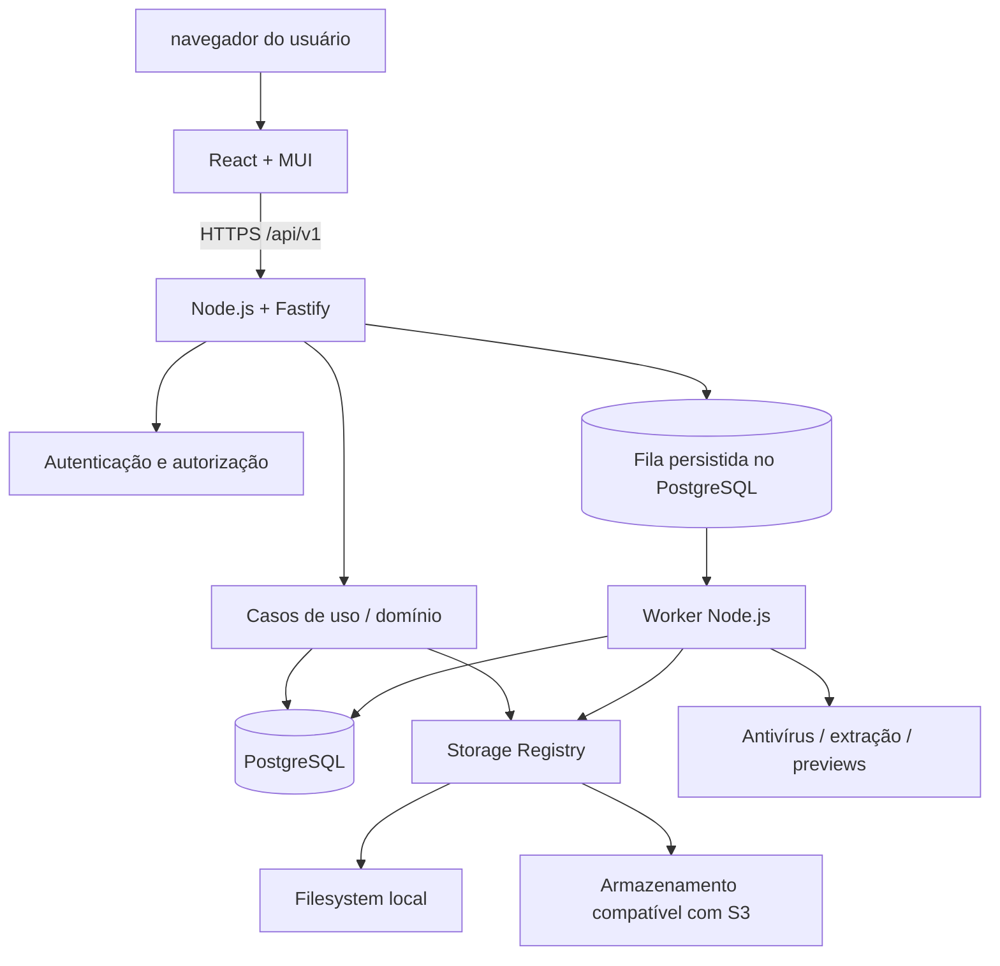
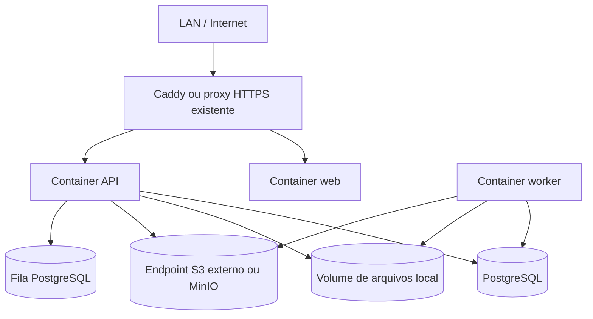
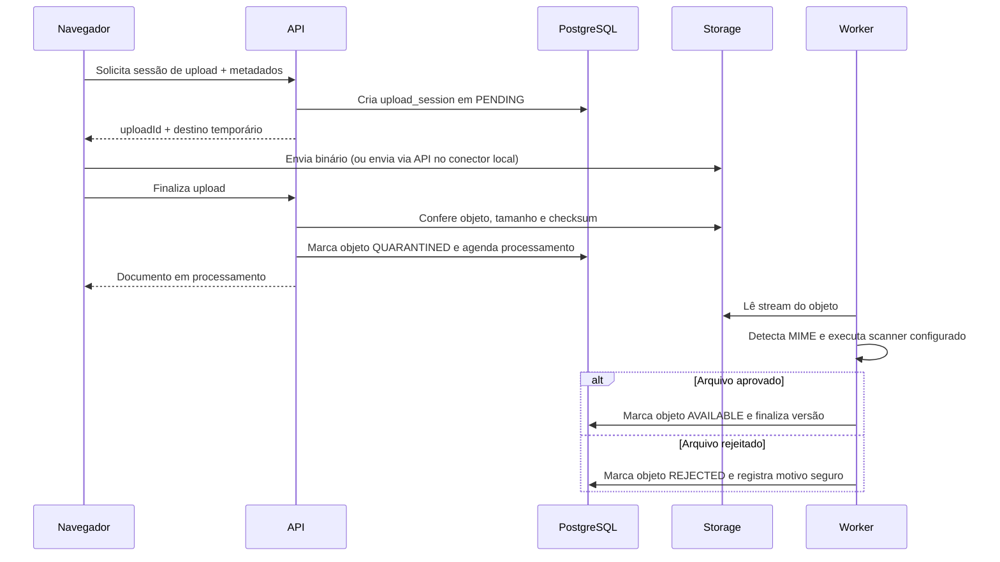
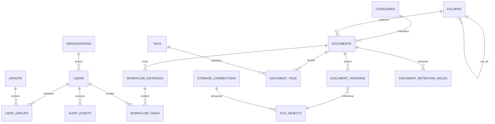
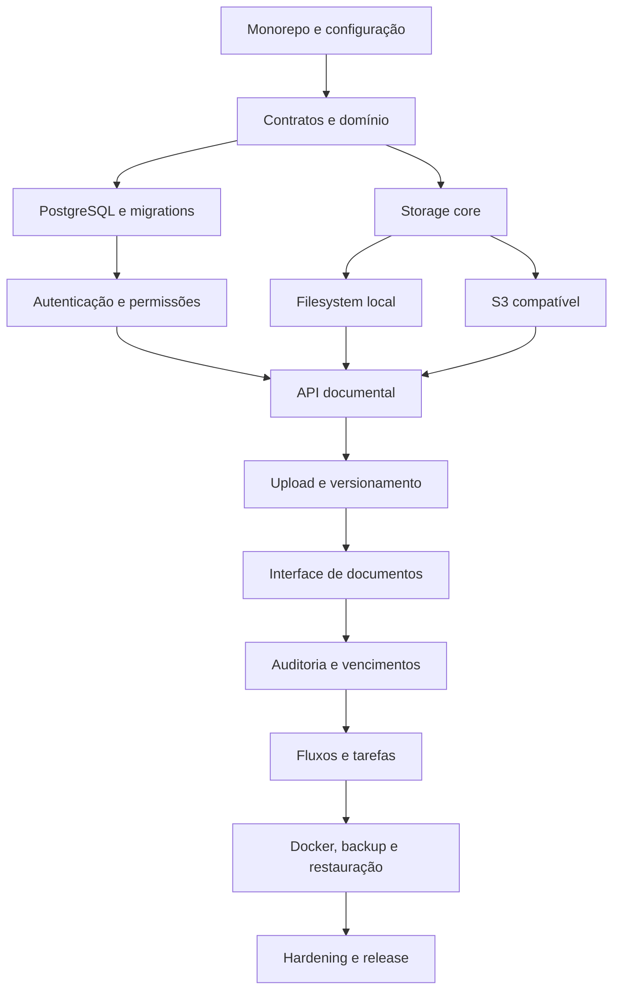

# DOCUFLOW — DOCUMENTO MESTRE DE PRODUTO E ARQUITETURA TÉCNICA

> **Codinome provisório:** DocuFlow. O nome deve ser validado quanto a marca, domínio e disponibilidade antes de qualquer lançamento público.
>
> **Versão do documento:** 1.0  
> **Idioma do produto inicial:** Português do Brasil (`pt-BR`)  
> **Modelo inicial de implantação:** self-hosted, uma instalação por organização  
> **Objetivo:** especificar um GED (Gerenciador Eletrônico de Documentos) empresarial, modular, seguro e extensível, construído como monorepo.

---

# ENTREGÁVEL A — DEFINIÇÃO DO PRODUTO E POSICIONAMENTO

## A.1 Visão

Criar um sistema de gestão documental que permita a uma empresa centralizar seus arquivos, estruturar informações sobre eles, controlar versões e acessos, acompanhar vencimentos e conduzir processos de revisão e aprovação. O sistema deve ser simples de instalar, operar e manter em infraestrutura própria.

## A.2 Missão

Substituir a desorganização de documentos espalhados entre pastas de rede, e-mails, planilhas e conversas por um repositório empresarial rastreável. O produto não deve ser somente um lugar para guardar PDFs: cada documento precisa possuir identidade, metadados, versão, responsáveis, permissões e histórico.

## A.3 Posicionamento

**DocuFlow é um GED self-hosted para empresas que precisam organizar e controlar documentos e seus processos sem entregar o controle dos arquivos a uma plataforma externa.**

O produto deve ocupar o espaço entre:

- um armazenamento genérico de arquivos, que organiza pastas, mas não entende o ciclo de vida documental; e
- suítes corporativas grandes, cuja implantação, administração e custo podem ser excessivos para pequenas e médias empresas.

O posicionamento não deve prometer certificação legal, validade jurídica automática ou conformidade regulatória garantida. O sistema fornece controles técnicos e registros que ajudam a empresa a governar seus documentos; a interpretação das obrigações legais continua sendo responsabilidade da organização e de seus assessores.

## A.4 Usuários e personas

| Persona | Objetivo | Necessidades principais |
|---|---|---|
| Administrador do sistema | Manter a instalação saudável | Usuários, grupos, permissões, storage, backups e configurações |
| Gestor documental | Organizar o acervo | Pastas, categorias, metadados, retenção, pesquisa e relatórios |
| Colaborador | Encontrar e enviar documentos | Upload simples, filtros, visualização e histórico |
| Revisor/aprovador | Revisar documentos atribuídos | Fila de tarefas, comparação de versões, aprovação e solicitação de correção |
| Auditor/consulta | Ver evidências sem alterar dados | Acesso somente leitura, histórico e exportação autorizada |

## A.5 Princípios de produto

1. **O arquivo não é o documento inteiro.** O registro documental e seus metadados devem existir separadamente do objeto binário armazenado.
2. **Versões são imutáveis.** Uma substituição cria uma nova versão; nunca sobrescreve silenciosamente o conteúdo aprovado anteriormente.
3. **Permissão é aplicada no servidor.** Ocultar um botão na interface não é controle de acesso.
4. **Armazenamento é um adaptador.** O domínio não deve depender de SDK de S3, Azure, Google ou do filesystem local.
5. **Self-hosted é o primeiro cenário real.** Instalação, atualização, backup, restauração e diagnóstico precisam ser documentados e testados.
6. **Auditoria é parte do domínio.** Ações relevantes precisam produzir eventos estruturados, não apenas linhas de log técnico.
7. **Automação gradual.** A primeira versão terá fluxos documentais objetivos e previsíveis; não será um construtor genérico de BPMN.
8. **Sem dependência obrigatória de nuvem do fornecedor.** A instalação deve funcionar sem telemetria ou serviços externos proprietários.
9. **Portabilidade.** Os arquivos devem ser exportáveis em formatos comuns e os metadados devem poder ser extraídos do PostgreSQL.
10. **Segurança por padrão.** Links temporários, uploads validados, segredos protegidos e backups protegidos desde o início.

## A.6 Casos de uso prioritários

1. Guardar contratos, notas, laudos, certificados, documentos de fornecedores, documentos de funcionários e relatórios.
2. Classificar arquivos por categoria, pasta, etiquetas e campos personalizados.
3. Pesquisar documentos por nome, categoria, responsável, data, vencimento, status e metadados.
4. Criar uma nova versão sem perder a versão anterior.
5. Encaminhar um documento para revisão e aprovação.
6. Ver quem enviou, visualizou, baixou, alterou metadados, aprovou ou arquivou um documento.
7. Acompanhar documentos com vencimento próximo.
8. Restringir documentos por usuário, grupo, pasta e categoria.
9. Exportar um documento ou um conjunto autorizado de documentos com seus metadados.
10. Armazenar arquivos em disco local ou em um serviço compatível com S3, sem acoplar o restante da aplicação ao provedor.

## A.7 Limites explícitos do produto inicial

### Dentro do escopo

- Uma organização por instalação self-hosted.
- Autenticação local e gestão básica de usuários e grupos.
- Repositório documental, pastas, categorias, etiquetas e metadados configuráveis.
- Upload, download, visualização de PDF/imagem e versionamento.
- Permissões por papel e escopo de recurso.
- Auditoria de ações importantes.
- Vencimentos e notificações internas.
- Fluxos simples de revisão e aprovação humana.
- Conectores de armazenamento local e S3 compatível.
- Administração do storage, verificação de saúde, backup e restauração documentados.
- Implantação por Docker Compose.

### Fora do escopo da primeira versão

- Assinatura eletrônica própria ou certificação ICP-Brasil.
- Digitalização física com hardware especializado.
- OCR e classificação por IA como requisito obrigatório.
- Editor de DOCX/PDF no navegador.
- Gestão fiscal, contábil, trabalhista ou jurídica.
- Repositório público com links permanentes e indexação por mecanismos de busca.
- Motor BPMN completo ou automações arbitrárias.
- Sincronização bidirecional com Google Drive, SharePoint ou Dropbox.
- Aplicativos nativos para Android/iOS.
- SaaS multi-tenant compartilhado no primeiro lançamento.

---

# ENTREGÁVEL B — INVENTÁRIO FUNCIONAL

| # | Subsistema | Finalidade | Recursos principais | MVP |
|---:|---|---|---|---|
| 1 | Identidade e acesso | Identificar usuários e limitar ações | Login, sessão, usuários, grupos, papéis, recuperação de senha | Essencial |
| 2 | Organização | Representar a empresa instalada | Dados da organização, preferências, fuso horário, logotipo | Essencial |
| 3 | Repositório documental | Manter documentos e seus registros | Upload, detalhe, status, download e arquivamento | Essencial |
| 4 | Pastas | Criar organização hierárquica | Árvore, movimentação, navegação e permissões herdadas | Essencial |
| 5 | Categorias | Padronizar tipos de documento | Tipos, descrição, campos adicionais e cor/ícone | Essencial |
| 6 | Metadados | Registrar atributos pesquisáveis | Campos texto, número, data, opção única/múltipla e obrigatório | Essencial |
| 7 | Etiquetas | Adicionar classificações transversais | Criar, remover e filtrar tags | Essencial |
| 8 | Versionamento | Preservar histórico de arquivos | Nova versão, versão vigente, autor, data, checksum e restauração lógica | Essencial |
| 9 | Visualização | Consultar conteúdo sem baixar | PDF e imagem; demais formatos como download | Essencial |
| 10 | Armazenamento | Persistir os binários | Adaptadores local e S3 compatível, health check e roteamento simples | Essencial |
| 11 | Upload seguro | Receber arquivos com segurança | Limites, streaming, quarentena, MIME real, checksum e varredura configurável | Essencial |
| 12 | Pesquisa | Encontrar documentos | Nome, campos padrão, categoria, pasta, etiqueta e filtros combinados | Essencial |
| 13 | Fluxos | Coordenar revisão e aprovação | Definições simples, instâncias, tarefas, aprovar, rejeitar e solicitar ajuste | MVP ampliado |
| 14 | Vencimentos | Antecipar documentos próximos do vencimento | Datas, alertas, filtros e notificações internas | Essencial |
| 15 | Auditoria | Reconstruir ações relevantes | Evento, ator, recurso, horário, resultado e origem técnica limitada | Essencial |
| 16 | Retenção e exclusão | Evitar descarte acidental | Lixeira, política configurável, bloqueio/hold e exclusão rastreável | Básico |
| 17 | Administração de storage | Configurar destinos de arquivos | Conexões, teste, destino padrão e política por categoria | Essencial |
| 18 | Operação self-hosted | Instalar e manter | Docker Compose, migrações, health checks, backup, restauração e atualização | Essencial |
| 19 | Notificações | Informar tarefas e vencimentos | Caixa de notificações e e-mail SMTP configurável | Básico |
| 20 | Relatórios | Enxergar o estado do acervo | Totais por categoria, status, vencimentos e espaço utilizado | Básico |

## B.1 Prioridade por entrega

- **Fundação técnica:** monorepo, configuração, banco, API, interface, autenticação e instalação.
- **MVP funcional:** documentos, categorias, pastas, metadados, upload, storage local, storage S3, versões, busca, permissões e auditoria.
- **MVP operacional completo:** fluxos de aprovação, tarefas, vencimentos, notificações, exclusão controlada, backup e restauração testados.
- **Pós-MVP:** OCR, extração de texto, busca em conteúdo, Azure Blob, Google Cloud Storage, migração entre storages, e-mail avançado e OIDC.

---

# ENTREGÁVEL C — ARQUITETURA TÉCNICA COMPLETA

## C.1 Visão macro

O produto será um **monólito modular**, distribuído em três processos principais: aplicação web, API e worker. PostgreSQL será a fonte de verdade dos metadados e do estado dos processos. Os binários serão armazenados por adaptadores independentes.



### Responsabilidades

- **Web:** experiência de usuário, formulários, tabelas, visualizador e estados de interface. Não contém segredos nem decide autorização final.
- **API:** autenticação, validação, autorização, transações, contratos HTTP, geração de alvos de upload/download temporários e orquestração de casos de uso.
- **Worker:** operações demoradas e recuperáveis: verificação de arquivos, varredura, geração de prévias, notificações, vencimentos e limpeza de temporários.
- **PostgreSQL:** metadados, usuários, permissões, documentos, versões, tarefas, auditoria, fila e configurações não secretas.
- **Storage provider:** recebe, lê, verifica, copia e remove os objetos binários. O banco guarda apenas a referência lógica e os dados técnicos necessários.

## C.2 Arquitetura do monorepo

A estrutura inicial proposta é:

```text
docuflow/
├── project.md
├── EXECUTION_PLAN.md
├── README.md
├── package.json
├── pnpm-workspace.yaml
├── pnpm-lock.yaml
├── tsconfig.base.json
├── biome.json
├── vitest.workspace.ts
├── .gitignore
├── .env.example
├── apps/
│   ├── web/                         # React + Vite + MUI
│   ├── api/                         # Fastify HTTP API
│   └── worker/                      # Processamento assíncrono
├── packages/
│   ├── contracts/                   # Zod schemas e contratos HTTP compartilhados
│   ├── domain/                      # Entidades, regras e casos de uso
│   ├── database/                    # Drizzle schema, migrations e repositories
│   ├── auth/                        # Sessões, credenciais e políticas de acesso
│   ├── storage-core/                # Interfaces, registry, capabilities e erros
│   ├── storage-local/               # Adaptador de filesystem local
│   ├── storage-s3/                  # Adaptador S3 compatível
│   ├── file-processing/             # MIME, checksum, scanner e preview pipeline
│   ├── notifications/               # Notificações internas e SMTP
│   ├── ui/                          # Tema MUI, tokens e componentes compartilhados
│   └── config/                      # Configuração validada e tipos compartilhados
├── infra/
│   ├── compose/
│   ├── caddy/
│   └── monitoring/
├── scripts/
│   ├── backup/
│   ├── restore/
│   └── maintenance/
├── docs/
│   ├── installation.md
│   ├── backup-restore.md
│   ├── storage-connectors.md
│   ├── security.md
│   └── operations.md
└── tests/
    └── e2e/
```

### Regras de dependência entre pacotes

1. `contracts` não importa `apps/*` nem `database`.
2. `domain` depende de contratos de porta/interfaces, nunca de Fastify, React ou SDK de storage concreto.
3. `storage-local` e `storage-s3` implementam exclusivamente contratos publicados por `storage-core`.
4. `database` implementa repositórios/portas definidos pelo domínio, sem colocar regra de negócio em handlers HTTP.
5. `api` compõe os módulos, registra adaptadores e expõe os endpoints.
6. `worker` reutiliza os casos de uso e registra consumidores de tarefas.
7. `web` consome apenas API/contratos públicos; não importa driver PostgreSQL ou SDK de storage.
8. Dependências entre workspaces devem usar exports públicos; evitar imports por caminhos internos de outro pacote.

## C.3 Stack tecnológica selecionada

| Camada | Tecnologia | Justificativa |
|---|---|---|
| Linguagem | TypeScript em modo strict | Contratos explícitos entre API, domínio, worker e UI |
| Runtime | Node.js LTS compatível | Ecossistema comum para API, processamento e ferramentas |
| Gerenciador | pnpm workspaces | Monorepo com dependências centralizadas |
| Frontend | React + Vite | SPA empresarial simples de publicar e servir |
| Componentes | MUI (`@mui/material`) | Componentes acessíveis e consistentes |
| Linguagem visual | Material Design 3 customizado | Tokens, estados, superfícies e hierarquia visual próprios |
| API | Fastify | Modularidade, validação e bom suporte TypeScript |
| Contratos | Zod + OpenAPI | Validação de entrada/saída e documentação HTTP |
| Banco | PostgreSQL | Integridade relacional, JSONB, índices e transações |
| ORM | Drizzle ORM | Schema TypeScript e SQL/migrations transparentes |
| Estado remoto | TanStack Query | Cache, mutações, invalidação e loading/error states |
| Formulários | React Hook Form + Zod | Formulários tipados e validação consistente |
| Tabelas | MUI X Data Grid ou TanStack Table com MUI | Listas densas com ordenação, filtros e paginação no servidor |
| Worker/fila | pg-boss ou alternativa PostgreSQL-backed validada em PoC | Evitar Redis obrigatório no primeiro deploy |
| Testes | Vitest + Playwright + Testcontainers | Unitários, integração, banco real e E2E |
| Qualidade | Biome | Formatação e lint em um único fluxo |
| Deploy | Docker Compose + proxy reverso | Instalação repetível em VPS ou servidor local |

### Observação importante sobre Material UI 3

`@mui/material` é a biblioteca React de componentes; **Material Design 3 é a especificação visual**. O produto deve usar MUI como implementação, com tema, tokens, estados e componentes customizados para aproximar a experiência do Material Design 3. Não se deve afirmar que o tema padrão do MUI é uma implementação oficial e completa de Material 3.

O tema deve centralizar `colorSchemes`, tipografia, espaçamento, elevação, densidade, estados de foco/hover/disabled, shape e contraste. Não espalhar valores de cor diretamente pelos componentes.

## C.4 Modelo de implantação self-hosted

### Topologia padrão



### Containers do Compose

- `web`: build estático servido por Nginx ou servidor HTTP leve.
- `api`: processo Fastify, sem privilégios de root.
- `worker`: processo de tarefas assíncronas.
- `postgres`: banco primário com volume persistente e health check.
- `caddy`: proxy reverso opcional com TLS automático quando acessível pela Internet.
- `clamav`: serviço opcional por profile de Compose para análise antimalware.
- `minio`: opcional para laboratório/demo; não deve ser obrigatório se o cliente já possui endpoint S3.

O storage local deve utilizar volume persistente separado do container. Não armazenar documentos dentro do filesystem efêmero da imagem.

### Perfil de instalação

- **Instalação simples:** Web + API + Worker + PostgreSQL e storage local.
- **Instalação com objeto:** mesma composição, com endpoint S3/MinIO configurado externamente.
- **Instalação atrás de proxy existente:** não iniciar Caddy; documentar os headers confiáveis e o TLS no proxy externo.

## C.5 Arquitetura de múltiplos conectores de armazenamento

### Objetivo

A aplicação deve suportar provedores diferentes sem alterar o domínio documental. Cada versão de documento aponta para a conexão de storage na qual seu objeto foi gravado. O provedor não pode ser inferido apenas pela extensão ou pelo nome do arquivo.

### Conectores previstos

| Conector | Entrega | Uso |
|---|---|---|
| Filesystem local | MVP | Diretório persistente montado no servidor |
| S3 compatível | MVP | MinIO, AWS S3 e outros endpoints compatíveis, após teste de compatibilidade |
| Azure Blob Storage | Pós-MVP | Conta e container configurados pelo administrador |
| Google Cloud Storage | Pós-MVP | Bucket configurado pelo administrador |
| WebDAV/SFTP | Avaliar depois | Preferencialmente para importação/integração, não como backend primário sem teste de consistência |

### Princípios do contrato de storage

- O domínio utiliza uma interface de capacidades; não importa SDK de provedor.
- O identificador do objeto é gerado pelo backend e é opaco.
- O nome original do arquivo é metadado; nunca é usado diretamente como caminho físico.
- Cada objeto possui tamanho, MIME detectado, checksum SHA-256 e conexão de destino.
- Upload e download devem permitir streaming, sem carregar o arquivo inteiro na memória.
- Links assinados são opcionais e têm validade curta. O fallback é streaming pela API.
- Credenciais de provedores são armazenadas criptografadas; a chave mestra vem de segredo externo ao banco.
- Exclusões e cópias devem ser idempotentes ou registrar claramente o estado pendente para reconciliação.
- Falhas de storage não podem apagar o registro documental nem resultar em aprovação falsa.
- Não usar deduplicação global entre organizações na primeira versão, pois ela pode produzir canais laterais de existência de arquivos.

### Contrato TypeScript de referência

```ts
import type { Readable } from "node:stream";

export type StorageProviderKind = "local" | "s3" | "azure_blob" | "google_cloud";

export interface StorageObjectKey {
  value: string;
}

export interface StorageObjectMetadata {
  contentType: string;
  contentLength: number;
  checksumSha256: string;
  customMetadata?: Readonly<Record<string, string>>;
}

export interface StoredObject extends StorageObjectMetadata {
  key: StorageObjectKey;
  etag?: string;
  providerVersionId?: string;
}

export interface StorageCapabilities {
  streamingRead: boolean;
  streamingWrite: boolean;
  signedUpload: boolean;
  signedDownload: boolean;
  multipartUpload: boolean;
  serverSideCopy: boolean;
}

export interface StorageUploadInput {
  key: StorageObjectKey;
  body: Readable;
  metadata: StorageObjectMetadata;
  abortSignal?: AbortSignal;
}

export interface StorageDownload {
  body: Readable;
  metadata: StorageObjectMetadata;
}

export interface SignedStorageTarget {
  url: string;
  method: "PUT" | "GET";
  headers: Readonly<Record<string, string>>;
  expiresAt: Date;
}

export interface StorageProvider {
  readonly kind: StorageProviderKind;
  readonly capabilities: StorageCapabilities;
  checkHealth(): Promise<{ healthy: boolean; message: string; checkedAt: Date }>;
  putObject(input: StorageUploadInput): Promise<StoredObject>;
  getObject(key: StorageObjectKey): Promise<StorageDownload>;
  headObject(key: StorageObjectKey): Promise<StoredObject | null>;
  deleteObject(key: StorageObjectKey): Promise<void>;
  createSignedUploadTarget?(input: {
    key: StorageObjectKey;
    contentType: string;
    contentLength: number;
    expiresInSeconds: number;
  }): Promise<SignedStorageTarget>;
  createSignedDownloadTarget?(input: {
    key: StorageObjectKey;
    expiresInSeconds: number;
    downloadName?: string;
  }): Promise<SignedStorageTarget>;
}
```

A interface é um contrato arquitetural. A assinatura final deve ser ajustada para compatibilidade com os streams e SDKs concretos escolhidos, mantendo as garantias acima. Não usar `any` para contornar diferenças entre conectores.

### Registro e seleção de conectores

`storage-core` fornece `StorageProviderRegistry`, validação de capacidades e erros normalizados. `storage-local` e `storage-s3` registram factories. A API recebe apenas `storageConnectionId` e uma referência lógica de objeto.

No MVP:

1. O administrador poderá cadastrar mais de uma conexão de storage.
2. Poderá testar a conexão e definir o destino padrão da instalação.
3. Poderá criar uma regra simples de destino padrão por categoria documental.
4. Cada arquivo/versão guardará o `storage_connection_id` efetivamente utilizado.
5. Alterar uma regra não moverá arquivos antigos.
6. Migração automatizada entre provedores será uma funcionalidade separada, com verificação de checksum e relatório, prevista para pós-MVP.

### Chaves de objeto

Formato lógico sugerido:

```text
org/{organizationId}/documents/{documentId}/versions/{versionId}/{objectId}
```

O caminho não contém nome original, CPF, e-mail, nome de cliente ou outro dado pessoal. O banco guarda a referência; a UI nunca recebe credenciais permanentes do provedor.

## C.6 Ciclo de upload seguro



Regras obrigatórias:

- Validar tamanho máximo antes e durante o streaming.
- Verificar assinatura/binário do arquivo; não confiar somente em `Content-Type` do navegador.
- Gerar chave de objeto no servidor.
- Proteger contra path traversal, nomes maliciosos, arquivos compactados expansivos e MIME polyglot.
- Detectar checksum e tamanho divergentes.
- Manter arquivos em quarentena até o processamento concluir.
- Nunca permitir download normal de objeto em quarentena ou rejeitado.
- Limpar sessões incompletas por job com janela de segurança.
- Tratar upload repetido/finalização repetida de forma idempotente.
- Registrar o evento de envio e o resultado da análise.
- Arquivos acima do limite de upload direto devem usar multipart/streaming ou ser recusados com mensagem clara; nunca usar `Buffer` ilimitado.

## C.7 Ciclo de vida de documento e versão

### Separação de conceitos

- **Documento:** identidade lógica, título, categoria, pasta, status, metadados e relações.
- **Versão:** snapshot imutável de um arquivo e seus dados técnicos.
- **Objeto:** localização física no storage, checksum e informação de integridade.
- **Processo:** revisão/aprovação que aponta para uma versão específica.

### Estados sugeridos do documento

`DRAFT`, `IN_REVIEW`, `APPROVED`, `REJECTED`, `ARCHIVED`, `EXPIRED`, `DELETED`.

Os estados devem ser alterados por casos de uso válidos, não por edição arbitrária de um campo. O status de processamento do arquivo (`UPLOADING`, `QUARANTINED`, `AVAILABLE`, `REJECTED`, `MISSING`, `DELETE_PENDING`) é independente do status documental.

### Regras de versionamento

1. Versões são append-only e não podem ser editadas depois da finalização.
2. Uma nova versão recebe número crescente e novo `file_object_id`.
3. O documento aponta para a versão corrente por `current_version_id`.
4. Uma aprovação deve registrar exatamente qual versão foi aprovada.
5. Se uma nova versão for enviada durante uma aprovação, a instância em andamento não deve aprovar silenciosamente a nova versão; deve ser cancelada ou mantida associada à versão anterior conforme regra explícita.
6. Restaurar uma versão anterior cria uma nova versão baseada no conteúdo histórico; não reescreve o histórico.
7. O checksum deve permitir verificar integridade após upload, cópia e restauração.

## C.8 Fluxos de revisão e aprovação

O MVP terá fluxos simples e versionados, sem construtor BPMN.

### Modelo inicial

- Um fluxo contém etapas sequenciais.
- Cada etapa define aprovador individual, grupo ou papel.
- A tarefa pode ser aprovada, rejeitada ou devolvida para correção.
- Cada instância guarda a versão do fluxo e a versão documental que iniciou o processo.
- A decisão exige comentário quando rejeitar ou solicitar ajuste.
- Tarefas pendentes podem ter prazo e notificação.
- Alterações na definição do fluxo não modificam instâncias em andamento.

### Estados da tarefa

`PENDING`, `APPROVED`, `REJECTED`, `CHANGES_REQUESTED`, `CANCELLED`, `EXPIRED`.

### Garantias

- Apenas usuários autorizados podem executar a tarefa.
- Uma tarefa só pode receber uma decisão final válida; concorrência retorna conflito `409`.
- A ação e a transição são persistidas na mesma transação do banco.
- A versão documental não muda durante a decisão.
- O histórico do fluxo deve ser auditável.

## C.9 Autenticação, autorização e modelo de permissões

### Autenticação inicial

- Usuário e senha local.
- Hash de senha com Argon2id ou algoritmo atual validado pela equipe.
- Sessão de servidor com cookie `HttpOnly`, `Secure` em produção e `SameSite` apropriado.
- Proteção CSRF compatível com o modelo de sessão.
- Recuperação de senha com token aleatório de uso único, armazenado como hash e com expiração.
- Limite de tentativas e rate limiting.
- MFA TOTP pode entrar no MVP completo; OIDC/LDAP fica pós-MVP.

### Papéis iniciais

| Papel | Permissões padrão |
|---|---|
| Administrador | Administração completa, inclusive configuração de storage e usuários |
| Gestor documental | Documentos, categorias, pastas, metadados, fluxos e relatórios |
| Colaborador | Criar documentos e editar o que lhe for permitido |
| Revisor | Visualizar documentos atribuídos e executar tarefas de aprovação |
| Consulta | Leitura de recursos autorizados, sem alterar conteúdo |

Papéis são conjuntos de permissões, não substitutos de escopo. Um usuário pode ser revisor de uma categoria e apenas leitor de outra.

### Escopos

- Global da instalação.
- Categoria.
- Pasta (com herança configurável).
- Documento individual, para exceções explícitas.

O backend deve verificar `action + resource + scope`. A interface apenas reflete permissões calculadas pelo servidor.

### Regras de herança

- Permissões de pasta podem ser herdadas por subpastas.
- Exceções explícitas devem ser visíveis e auditáveis.
- A precedência entre concessão e negação deve ser definida e testada antes da implementação; recomendação: negação explícita vence concessão herdada.
- Uma mudança de permissão deve invalidar caches de autorização.

## C.10 Auditoria

Eventos mínimos:

- login bem-sucedido e falho;
- criação, edição de metadados, movimentação e arquivamento de documento;
- upload e criação de versão;
- visualização e download, conforme política configurada;
- mudança de permissão;
- decisão de fluxo;
- alteração de categoria, metadados e configuração de storage;
- exclusão, restauração e operação de retenção;
- operação administrativa sensível.

Cada evento deve incluir `id`, `occurred_at`, `actor_user_id` quando houver, `action`, `resource_type`, `resource_id`, `result`, `request_id` e metadados mínimos não sensíveis. Nunca registrar senha, token, URL assinada, segredo de storage, conteúdo binário ou payload integral de documento.

A tabela de auditoria é append-only para a aplicação normal. Correções administrativas não apagam eventos: são registradas como novos eventos. Logs de aplicação e auditoria de negócio são coisas diferentes.

## C.11 Retenção, lixeira e exclusão

- Exclusão lógica do documento deve retirar o item das listagens normais, mantendo rastreabilidade.
- A lixeira permite restauração até o prazo configurado.
- Exclusão física só ocorre após verificação de permissões, ausência de bloqueio/hold e cumprimento da janela de segurança.
- Objetos não devem ser apagados antes da confirmação do estado no banco; usar status `DELETE_PENDING` e job idempotente para reconciliar falhas.
- Políticas de retenção são configuradas pelo administrador e não representam aconselhamento jurídico ou prazos legais pré-definidos.
- A aplicação deve permitir um bloqueio de exclusão (legal hold) que impeça expurgo enquanto ativo.
- Exportação antes do encerramento da instalação deve incluir arquivos, metadados e documentação de referência.

## C.12 Segurança de credenciais e configuração

- Segredos de storage e SMTP não podem ser versionados em `.env.example`, banco em texto puro ou logs.
- Configurações sensíveis devem ser criptografadas com chave mestra montada como segredo/arquivo do ambiente ou fornecida por secret manager do cliente.
- A rotação de chave deve ser planejada; documentar como recriptografar credenciais.
- `.env.example` contém apenas nomes e exemplos não funcionais.
- A API só confia em headers de proxy explicitamente configurados.
- CORS deve aceitar somente origens configuradas.
- Upload/download usam autorização por documento antes de gerar URL temporária.
- SSRF: endpoint S3 customizado não pode permitir conexões arbitrárias da aplicação a endereços internos sem validação; restringir endpoint, protocolo, DNS e destinos conforme configuração.
- Não oferecer acesso shell, SQL livre ou path livre no painel administrativo.

## C.13 API e contratos HTTP

Prefixo: `/api/v1`.

Formato de erro recomendado:

```json
{
  "error": {
    "code": "DOCUMENT_VERSION_CONFLICT",
    "message": "O documento foi atualizado por outra pessoa.",
    "requestId": "uuid",
    "details": {}
  }
}
```

Endpoints iniciais sugeridos:

| Recurso | Método/rota | Uso |
|---|---|---|
| Sessão | `POST /auth/login` | Autenticar |
| Sessão | `POST /auth/logout` | Encerrar sessão |
| Sessão | `GET /auth/me` | Usuário atual e permissões resumidas |
| Documentos | `GET /documents` | Pesquisa paginada e filtrada |
| Documentos | `POST /documents` | Criar registro e sessão de upload |
| Documento | `GET /documents/:id` | Detalhe e metadados |
| Documento | `PATCH /documents/:id` | Atualizar metadados permitidos |
| Documento | `POST /documents/:id/versions` | Criar nova versão |
| Documento | `GET /documents/:id/versions` | Listar versões |
| Documento | `POST /documents/:id/download-target` | Solicitar download autorizado |
| Upload | `POST /uploads/:id/complete` | Finalizar sessão |
| Categorias | `GET/POST/PATCH /categories` | Administrar categorias |
| Pastas | `GET/POST/PATCH /folders` | Administrar pastas |
| Fluxos | `POST /documents/:id/workflows` | Iniciar aprovação |
| Tarefas | `GET /tasks` | Listar tarefas do usuário |
| Tarefas | `POST /tasks/:id/decision` | Aprovar/rejeitar/devolver |
| Storage | `GET/POST /admin/storage-connections` | Configurar conexões |
| Storage | `POST /admin/storage-connections/:id/test` | Testar conexão |
| Auditoria | `GET /admin/audit-events` | Consultar eventos autorizados |
| Saúde | `GET /health/live`, `/health/ready` | Health checks |

Filtros e paginação devem ser executados no PostgreSQL. Não carregar todos os documentos para filtrar no navegador. Ordenação deve usar campos permitidos e estáveis, com ordenação secundária por ID.

## C.14 Pesquisa e indexação

MVP:

- nome/título;
- nome original do arquivo;
- categoria, pasta, tags e status;
- responsável, autor e datas;
- campos padrão e metadados configurados;
- filtros combináveis e paginação no servidor.

Pós-MVP:

- extração de texto de PDF e Office;
- full-text search do PostgreSQL;
- OCR por serviço/worker opcional;
- indexação em mecanismo dedicado somente se volume e requisitos justificarem.

A pesquisa não deve expor documentos sem permissão. Aplicar o filtro de acesso antes de contar, paginar ou retornar resultados para evitar vazamento por totais.

## C.15 Observabilidade e suporte

- Logs estruturados em JSON com `request_id` e `job_id`.
- Métricas de saúde do API, worker, banco, fila e storages configurados.
- Health checks separados para processo vivo e dependências prontas.
- Erros apresentados ao usuário com mensagem compreensível e código de referência; detalhes técnicos ficam no log.
- Telemetria externa desativada por padrão.
- Diagnóstico/export de configuração não inclui segredos, conteúdo dos documentos ou URLs assinadas.

---

# ENTREGÁVEL D — MODELO DE DADOS E CONTRATOS DE DOMÍNIO

## D.1 Entidades principais



## D.2 Tabelas propostas

### Organização e acesso

- `organizations`: dados da instalação/empresa, idioma e fuso horário.
- `users`: identidade, e-mail normalizado, nome, hash de senha, estado e timestamps.
- `groups`: grupos de trabalho.
- `user_groups`: vínculo usuário/grupo.
- `roles`: papéis do sistema.
- `permissions`: catálogo de ações.
- `role_permissions`: permissões por papel.
- `user_role_scopes`: atribuições de papéis com escopo opcional.
- `sessions`: sessões, hashes de tokens, expiração e revogação.

### Estrutura documental

- `folders`: árvore hierárquica, pai, nome, caminho materializado opcional e estado.
- `categories`: tipos documentais e configuração de metadados.
- `category_fields`: campos extras, tipo, obrigatoriedade, opções e regras de validação.
- `tags`: etiquetas.
- `documents`: identidade, título, categoria, pasta, status, responsável, datas e versão corrente.
- `document_metadata`: valores personalizados validados segundo a categoria.
- `document_tags`: vínculo N:N.
- `document_versions`: número, autor, versão do objeto, descrição e data.
- `file_objects`: conexão de storage, chave opaca, tamanho, MIME, checksum e estado de processamento.
- `upload_sessions`: estado, expiração, limite, objeto temporário e idempotency key.

### Storage

- `storage_connections`: tipo, nome, configuração não secreta, referência a segredo criptografado, status e health check.
- `storage_routing_rules`: destino padrão e exceções por categoria.
- `storage_operations`: operações pendentes, cópias, exclusões e tentativas para reconciliação.

### Processos e governança

- `workflow_definitions`: definição lógica do fluxo.
- `workflow_definition_versions`: snapshot imutável da definição.
- `workflow_instances`: fluxo executado para documento e versão documental.
- `workflow_tasks`: responsável/grupo, etapa, prazo e estado.
- `workflow_decisions`: ator, decisão, comentário e timestamp.
- `notifications`: notificações internas e estado de leitura.
- `retention_policies`: regras de retenção configuradas pelo cliente.
- `document_retention_holds`: bloqueios de expurgo.
- `audit_events`: trilha de auditoria append-only.
- `outbox_events`: publicação confiável de eventos para worker/fila.

### Infraestrutura operacional

- `app_settings`: configurações não secretas.
- `background_job_runs` ou tabelas da tecnologia de fila escolhida.
- `schema_migrations`: controle fornecido pela ferramenta de migrations.

## D.3 Regras de integridade

1. PKs UUID geradas no servidor.
2. Datas técnicas em `timestamptz`; datas civis (ex.: vencimento sem horário) em `date`.
3. `created_at`, `updated_at`, `created_by` e `updated_by` nos registros mutáveis relevantes.
4. Índices nas chaves estrangeiras e nos filtros usados em listas.
5. Unicidade de e-mail normalizado entre usuários ativos conforme política definida.
6. `document_versions(document_id, version_number)` único.
7. `file_objects.storage_connection_id + object_key` único.
8. `checksum_sha256` deve ter formato validado; a presença do checksum não substitui verificação de integridade no download/migração.
9. Referências a storage não podem ser apagadas enquanto existirem objetos vinculados.
10. Auditoria e decisões de fluxo não podem ser removidas pela UI comum.
11. Alterações concorrentes em documentos devem usar `version`/`updated_at` e retornar `409 Conflict` quando necessário.
12. Relacionamentos e regras de exclusão devem evitar cascatas físicas acidentais.

## D.4 Tipos TypeScript de referência

```ts
export type DocumentStatus =
  | "DRAFT"
  | "IN_REVIEW"
  | "APPROVED"
  | "REJECTED"
  | "ARCHIVED"
  | "EXPIRED"
  | "DELETED";

export type FileObjectStatus =
  | "UPLOADING"
  | "QUARANTINED"
  | "AVAILABLE"
  | "REJECTED"
  | "MISSING"
  | "DELETE_PENDING";

export interface DocumentRecord {
  id: string;
  organizationId: string;
  title: string;
  categoryId: string;
  folderId: string | null;
  status: DocumentStatus;
  currentVersionId: string | null;
  ownerUserId: string;
  issueDate: string | null;
  expirationDate: string | null;
  metadata: Readonly<Record<string, string | number | boolean | null | string[]>>;
  version: number;
  createdAt: string;
  updatedAt: string;
}

export interface DocumentVersionRecord {
  id: string;
  documentId: string;
  versionNumber: number;
  fileObjectId: string;
  uploadedByUserId: string;
  changeNote: string | null;
  createdAt: string;
}

export interface FileObjectRecord {
  id: string;
  storageConnectionId: string;
  objectKey: string;
  originalFileName: string;
  detectedContentType: string;
  sizeBytes: number;
  checksumSha256: string;
  status: FileObjectStatus;
  createdAt: string;
}
```

Tipos definitivos devem ser representados com schemas Zod nos contratos da API e tipos inferidos desses schemas quando apropriado. Não manter tipos duplicados divergentes.

---

# ENTREGÁVEL E — EXPERIÊNCIA DE USUÁRIO E DESIGN SYSTEM

## E.1 Estrutura de navegação inicial

```text
Visão geral
Documentos
Pastas
Categorias e campos
Fluxos de aprovação
Minhas tarefas
Vencimentos
Relatórios
--------------------
Administração
  Usuários e grupos
  Papéis e permissões
  Armazenamento
  Auditoria
  Configurações
```

## E.2 Telas do MVP

| Tela | Objetivo | Componentes fundamentais |
|---|---|---|
| Login | Acesso seguro | E-mail, senha, recuperação |
| Dashboard | Resumo do acervo | KPIs discretos, tarefas, vencimentos e atividade recente |
| Lista de documentos | Encontrar e operar documentos | Busca, filtros, tabela, paginação, seleção e ações autorizadas |
| Detalhe do documento | Consultar identidade e histórico | Preview, metadados, versões, permissões, atividade e ações |
| Envio de documentos | Criar registro e upload | Seleção, validação, categoria, metadados, pasta e progresso |
| Pastas | Navegar e organizar | Árvore, breadcrumbs, movimentação e criação |
| Categorias | Configurar tipos documentais | Campos dinâmicos, regras e destino de storage |
| Tarefas | Executar aprovações | Fila, detalhes, comentário e decisão |
| Vencimentos | Antecipar pendências | Filtros por período, categoria e responsável |
| Administração de storage | Configurar conectores | Tipo, endpoint, credenciais protegidas, teste e roteamento |
| Auditoria | Consultar eventos | Filtros, exportação autorizada e detalhe do evento |
| Usuários e grupos | Administrar acesso | Cadastro, desativação, grupo e papéis |

## E.3 Direção visual Material Design 3

- Layout desktop-first, responsivo para tablet e celular.
- Navegação lateral recolhível; área central clara e tabelas legíveis.
- Superfícies tonais discretas, divisores sutis e elevação contida.
- Cor primária azul ou azul-petróleo, com cores semânticas de sucesso, alerta e erro.
- Tipografia consistente, hierarquia clara e bom contraste.
- Campos e botões com dimensões compactas, adequadas a sistemas empresariais.
- Evitar gradientes decorativos, glassmorphism, excesso de cartões e cantos exageradamente arredondados.
- Ícones da biblioteca MUI Icons, sem emojis como substituto de ícones.
- Estados vazios devem orientar a próxima ação e não mostrar dados fictícios como se fossem reais.
- Todo controle visível deve funcionar; não entregar botões decorativos sem ação.

## E.4 Experiência de upload

1. Selecionar um ou vários arquivos.
2. Validar nome, tamanho e extensão no cliente apenas como pré-checagem.
3. Preencher título, categoria, pasta, responsável e metadados.
4. Enviar com progresso por arquivo.
5. Finalizar a sessão e exibir estado de processamento.
6. Mostrar sucesso somente quando a API confirmar o registro e o estado do arquivo.
7. Se ocorrer falha parcial em lote, indicar quais itens foram concluídos e quais precisam ser repetidos.

## E.5 Acessibilidade

Meta: WCAG 2.2 AA para fluxos principais. Garantir navegação por teclado, foco visível, nomes acessíveis, contraste, labels, mensagens de erro associadas aos campos, dialogs com foco gerenciado e tabelas utilizáveis com leitor de tela.

---

# ENTREGÁVEL F — STACK E DEPENDÊNCIAS

| Tecnologia | Uso | Política |
|---|---|---|
| React | Interface | Usar versão estável validada no bootstrap |
| Vite | Dev server/build web | Configuração por ambiente |
| MUI Material | Componentes React | Tema próprio alinhado à direção MD3 |
| MUI Icons | Ícones | Importar somente ícones usados |
| TypeScript | Linguagem | `strict: true`; sem `any` injustificado |
| Fastify | API | Plugins por módulo e schemas compartilhados |
| Zod | Validação | Validar entrada e configuração em runtime |
| PostgreSQL | Persistência | Migrações versionadas e backup testado |
| Drizzle ORM | Schema e consultas | SQL explícito para consultas críticas |
| pg-boss | Jobs | Somente após PoC de recuperação e concorrência |
| AWS SDK S3 | Conector S3 | Isolado em `storage-s3` |
| Node streams | Arquivos | Streaming para não consumir RAM proporcional ao arquivo |
| Vitest | Testes unitários/integração | Cobertura de regras críticas |
| Playwright | E2E | Fluxos principais de usuário |
| Testcontainers | PostgreSQL real nos testes | Evitar falsos positivos de mocks |
| Biome | Lint/format | Executado no CI |
| Docker Compose | Self-host | Imagens fixadas e volumes explícitos |

## F.1 Dependências que exigem decisão por PoC

- Biblioteca de fila PostgreSQL: validar manutenção, compatibilidade Node/PostgreSQL, retries, agendamento e observabilidade.
- Biblioteca de visualização PDF: validar acessibilidade, tamanho do bundle e comportamento de documentos grandes.
- Antivírus: validar integração ClamAV, timeout, arquivos acima de limite e indisponibilidade do scanner.
- MUI X Data Grid: avaliar licenciamento das funcionalidades necessárias; usar edição Community ou TanStack Table se recursos pagos forem necessários.
- Extração/preview Office: não adicionar LibreOffice ao MVP sem comprovar a necessidade e o custo operacional.

## F.2 Tecnologias evitadas inicialmente

- Microserviços: aumentam custo operacional sem necessidade demonstrada.
- Kubernetes: não necessário para a primeira instalação self-hosted.
- Redis obrigatório: evitar componente extra se a fila PostgreSQL atender ao volume.
- Banco NoSQL como repositório principal: o domínio é relacional.
- Base64 para armazenar arquivos no PostgreSQL: aumenta tamanho e pressão de memória.
- Links públicos permanentes: incompatíveis com o modelo de autorização previsto.
- Armazenamento de binários apenas em JSON/JSONB: inadequado para arquivos grandes.
- Dependência obrigatória de SaaS externo para autenticação, storage, OCR ou telemetria.

---

# ENTREGÁVEL G — ROADMAP DE IMPLEMENTAÇÃO

## G.1 Caminho crítico



## G.2 Fases

1. **Fundação do monorepo:** tooling, packages, convenções, CI e configuração tipada.
2. **Design system e shell web:** tema MUI, navegação, layout responsivo e estados globais.
3. **Contratos e domínio:** entidades, schemas, regras e casos de uso puros.
4. **Banco e persistência:** Drizzle, migrations, repositories e constraints.
5. **Autenticação e autorização:** sessões, usuários, grupos, papéis e escopos.
6. **Storage core e filesystem:** contrato, registry, driver local e testes de contrato.
7. **Conector S3:** credenciais, endpoint, upload/download, health check e compatibilidade.
8. **Pipeline de upload:** sessão, streaming, quarentena, checksum, validação e processamento.
9. **Gestão documental:** CRUD, pastas, categorias, tags, metadados e versionamento.
10. **Pesquisa e visualização:** filtros de servidor, paginação, preview de PDF/imagem e downloads.
11. **Fluxos e tarefas:** aprovação sequencial, decisões, prazos e notificações internas.
12. **Auditoria e retenção:** eventos, lixeira, holds e expurgo seguro.
13. **Administração:** usuários, permissões, storage, configurações e health checks.
14. **Self-host:** Docker Compose, proxy, upgrade, backup, restore e runbooks.
15. **Qualidade e segurança:** testes integrados, E2E, revisão de ameaças e desempenho.
16. **Documentação e release:** instalação limpa, dados de demonstração opcionais e checklist v1.0.

---

# ENTREGÁVEL H — DEFINIÇÃO FORMAL DO MVP

## H.1 Critério do MVP

O MVP está pronto quando uma empresa consegue instalar o sistema em servidor próprio, configurar ao menos um destino de storage, cadastrar usuários, enviar e encontrar documentos, controlar versões e permissões, aprovar documentos por um fluxo simples, consultar o histórico e recuperar a instalação a partir de backups testados.

## H.2 Matriz de escopo

| Capacidade | MVP | Critério de aceite |
|---|---|---|
| Instalação Docker | Sim | Instalação limpa documentada e repetível |
| Login local | Sim | Sessão segura, logout e recuperação de senha documentados |
| Usuários/grupos/papéis | Sim | Ações não autorizadas retornam 403 |
| Pastas/categorias/tags | Sim | Criar, editar, mover e filtrar |
| Metadados | Sim | Campos tipados e validação no servidor |
| Storage local | Sim | Upload/download/health check e persistência após restart |
| S3 compatível | Sim | MinIO e pelo menos um serviço real testados separadamente |
| Upload seguro | Sim | Limite, checksum, quarentena e estado de processamento |
| Versões | Sim | Histórico preservado e versão aprovada identificável |
| Busca | Sim | Filtros executados no banco e respeitando permissões |
| PDF/imagem preview | Sim | Preview autorizado e sem URL pública permanente |
| Aprovação humana | Sim | Fluxo sequencial com decisão e histórico |
| Auditoria | Sim | Eventos essenciais pesquisáveis |
| Vencimentos | Sim | Lista e notificação interna |
| Retenção/hold | Básico | Exclusão física bloqueada por hold |
| Backup/restore | Sim | Restauração completa demonstrada em ambiente limpo |
| OCR | Não | Pós-MVP |
| OIDC/LDAP | Não | Pós-MVP |
| Azure/GCS | Não | Pós-MVP |
| Migração automática entre storage | Não | Pós-MVP |
| SaaS multi-tenant | Não | Linha de produto futura |

## H.3 Cenário de demonstração de ponta a ponta

**Cenário: contrato de fornecedor**

1. Administrador instala a aplicação com Docker Compose e configura storage local ou S3.
2. Cria a categoria `Contrato de fornecedor` com campos `Fornecedor`, `CNPJ`, `Data de emissão`, `Vencimento` e `Responsável`.
3. Cria usuários para solicitante, jurídico e gestor.
4. Solicitante envia `Contrato_Fornecimento.pdf` e preenche os metadados.
5. API valida o envio; worker verifica integridade e executa a análise antimalware configurada.
6. Documento fica disponível com versão 1.
7. Solicitante inicia fluxo sequencial: jurídico → gestor.
8. Jurídico solicita ajuste com comentário; solicitante envia versão 2.
9. O fluxo anterior é encerrado ou reiniciado explicitamente; a versão 2 é enviada para nova aprovação.
10. Jurídico e gestor aprovam a versão 2.
11. Documento passa a `APPROVED`; a aprovação aponta para a versão 2.
12. O dashboard apresenta o documento, a tarefa concluída, o vencimento e a atividade.
13. Auditoria permite identificar quem enviou, revisou e aprovou.
14. Backup é executado; ambiente é restaurado e o checksum do arquivo é conferido.

---

# ENTREGÁVEL I — TESTES E VALIDAÇÃO

## I.1 Matriz de testes

| Camada | Ferramenta | O que precisa provar |
|---|---|---|
| Unitário | Vitest | Regras de domínio, transições, política de acesso e roteamento de storage |
| Contrato | Vitest + Zod | Payloads válidos/inválidos e compatibilidade entre UI/API |
| Adapter contract | Vitest | Todos os conectores cumprem o mesmo contrato |
| Integração API | Fastify inject + PostgreSQL | Rotas, transações, sessão, erros e permissões |
| Storage real | MinIO + filesystem temporário | Streaming, checksum, abort, falha e recuperação |
| Banco | Testcontainers | Constraints, migrations, concorrência e rollback |
| E2E | Playwright | Login, upload, busca, versão, aprovação e administração |
| Segurança | Testes específicos | IDOR, acesso horizontal, path traversal, MIME spoofing, SSRF e CSRF |
| Operação | Docker Compose | Restart, upgrade, backup, restore e health checks |
| Performance | k6 ou ferramenta equivalente | Busca paginada, uploads concorrentes e respostas sob carga definida |

## I.2 Gates de qualidade

- `pnpm lint` sem erros.
- `pnpm typecheck` sem erros.
- `pnpm test` aprovado.
- `pnpm test:integration` aprovado contra PostgreSQL real.
- `pnpm test:e2e` aprovado no cenário principal.
- Build Docker concluído com imagens fixadas.
- Instalação limpa e restauração de backup demonstradas.
- Nenhum endpoint retorna objeto sem autorização.
- Nenhum segredo presente no Git, logs ou respostas HTTP.

## I.3 Testes de segurança obrigatórios

1. Usuário sem permissão não consegue buscar, abrir, baixar ou inferir a existência de documento restrito.
2. Alterar `documentId` na URL não permite IDOR.
3. Usuário não consegue alterar `storageConnectionId`, `objectKey`, status de scan ou proprietário em payload não autorizado.
4. URL assinada expira e não pode ser reaproveitada além do prazo definido.
5. Path traversal e nome com caracteres de controle não alteram a pasta de destino.
6. MIME declarado pelo navegador não determina sozinho o tipo aceito.
7. Credenciais de storage nunca são retornadas à UI.
8. Configuração de endpoint S3 não permite SSRF arbitrário.
9. CSRF, sessão expirada e brute force são tratados.
10. A exclusão não remove arquivo protegido por retenção/hold.
11. Auditoria não registra tokens, segredos ou conteúdo de documentos.
12. Restauração de backup recupera metadados e arquivos correspondentes.

---

# ENTREGÁVEL J — RISCOS ARQUITETURAIS E ARMADILHAS A EVITAR

| # | Armadilha | Consequência | Mitigação obrigatória |
|---:|---|---|---|
| 1 | Guardar binário no PostgreSQL | Banco e backups crescem excessivamente | Binários em object storage; metadados no PostgreSQL |
| 2 | Sobrescrever arquivo em vez de criar versão | Perda de evidência histórica | Versões append-only com chave de objeto exclusiva |
| 3 | Confiar no nome/caminho enviado pelo usuário | Path traversal e colisões | Chave opaca gerada no servidor |
| 4 | Carregar upload inteiro em memória | OOM com arquivos grandes | Streams e limite de tamanho no proxy/API |
| 5 | Confiar no MIME do navegador | Arquivo malicioso mascarado | Detecção de conteúdo + allowlist configurável + scanner |
| 6 | Liberar download durante quarentena | Distribuição de arquivo ainda não verificado | Gate de estado `AVAILABLE` em toda leitura |
| 7 | Presumir que todos os storages suportam URL assinada | Fluxos quebrados em certos providers | Capability matrix e fallback por streaming |
| 8 | Vazar credenciais no browser | Comprometimento do bucket | Segredos somente no backend; URLs temporárias de escopo mínimo |
| 9 | Salvar URL como endereço físico do objeto | URLs expiram ou mudam | Guardar provider/connection e object key opaco |
| 10 | Trocar storage padrão sem rastrear arquivos antigos | Objetos inacessíveis | Persistir `storage_connection_id` por objeto |
| 11 | Mover arquivo e apagar origem sem validar destino | Perda definitiva | Copiar, conferir checksum, registrar e só então remover origem |
| 12 | Aprovar o documento atual em vez da versão da tarefa | Aprovação ambígua | Workflow aponta para `document_version_id` imutável |
| 13 | Permissão só no frontend | IDOR e acesso direto à API | Autorização por recurso no servidor e testes negativos |
| 14 | Herdar permissões sem regra de precedência | Escalada ou bloqueio de acesso | Formalizar e testar precedência de allow/deny |
| 15 | Excluir objeto antes da transação do banco | Registro aponta para arquivo inexistente | Estado de exclusão pendente + job idempotente |
| 16 | Excluir registro e fazer cascade em auditoria | Perda de trilha | Sem cascade para auditoria; eventos append-only |
| 17 | Contar resultados antes de aplicar permissão | Vazamento por contagem | Autorização antes de contar e paginar |
| 18 | Usar URL assinada longa | Compartilhamento involuntário | TTL curto, escopo a um objeto e registro da solicitação |
| 19 | Assumir que S3 compatível é idêntico em todos os provedores | Falhas de checksum, CORS ou multipart | Matriz de compatibilidade por provider e testes reais |
| 20 | Tratar endpoint S3 customizado como confiável | SSRF contra rede interna | Validar host, protocolo, DNS e destinos permitidos |
| 21 | Não limpar upload abandonado | Storage órfão e custo crescente | Job de expiração com período de segurança |
| 22 | Não tornar finalização idempotente | Versões duplicadas | Idempotency key e transação de conclusão |
| 23 | Executar tarefa longa dentro da requisição HTTP | Timeout e repetição inconsistente | Worker persistente e estado de processamento |
| 24 | Fila somente em memória | Jobs perdidos após restart | Fila persistida no PostgreSQL |
| 25 | Atualizar fluxo em execução | Tarefas antigas mudam de significado | Definições versionadas e instância fixa na versão |
| 26 | Misturar status documental e status do binário | Documento aprovado com arquivo indisponível | Máquinas de estado separadas e invariantes explícitos |
| 27 | Assumir que backup do banco inclui arquivos | Restore incompleto | Backup coordenado de banco, binários e configurações necessárias |
| 28 | Nunca testar restauração | Backup inutilizável | Restore automatizado e teste periódico |
| 29 | Atualizar containers sem migração controlada | Downtime ou corrupção | Backup, migration gate, health check e rollback documentado |
| 30 | Chave de criptografia existir só dentro do volume | Perda de credenciais após restore | Backup seguro da chave e procedimento de rotação/recuperação |
| 31 | Usar horário local sem fuso | Vencimentos/notificações incorretos | UTC no timestamp e timezone da organização para apresentação |
| 32 | Retenção jurídica codificada pelo fornecedor | Regra errada para o cliente | Políticas configuráveis; sem prometer prazo legal universal |
| 33 | Logar payload integral | Exposição de dados pessoais | Logging allowlist e redaction centralizada |
| 34 | Usar deduplicação global entre clientes | Canal lateral de existência de arquivos | Sem dedupe cross-tenant no início |
| 35 | Filtros client-side em acervos grandes | Lentidão e dados incompletos | Filtros, ordenação e paginação no PostgreSQL |
| 36 | Permitir que scanner indisponível resulte em aprovado | Falha de segurança silenciosa | Falha fechada ou exceção administrativa explícita e auditada |

## J.2 PoCs obrigatórias antes de ampliar o MVP

### PoC-A — Abstração de storage e paridade de conectores

- Implementar o contrato mínimo de storage.
- Rodar os mesmos testes de contrato contra filesystem e MinIO.
- Cobrir arquivo vazio, arquivo grande em streaming, abort, timeout, objeto inexistente, checksum divergente e falha parcial.
- Critério: mesmos resultados semânticos e erros normalizados em ambos os conectores; nenhum upload precisa carregar arquivo integral na RAM.

### PoC-B — Upload direto e streaming

- Comparar upload pelo backend e upload direto por URL temporária S3.
- Testar arquivo acima do limite de memória disponível para o container.
- Validar finalização idempotente, checksum e limpeza de sessões abandonadas.
- Critério: consumo de memória limitado e ausência de objeto acessível antes da liberação pelo worker.

### PoC-C — Backup e restauração coerentes

- Criar documentos em diferentes conectores.
- Fazer backup do PostgreSQL e dos volumes/objetos correspondentes.
- Restaurar em instalação limpa.
- Comparar contagem, metadados, versões, checksum e possibilidade real de download.
- Critério: 100% dos arquivos do conjunto de teste recuperados e verificáveis.

### PoC-D — Autorização documental

- Criar dois usuários com escopos diferentes.
- Exercitar listagem, busca, preview, download, histórico, tarefas e exportação.
- Alterar IDs manualmente para tentativa de IDOR.
- Critério: nenhum acesso fora do escopo e nenhuma inferência indevida por contagem ou erro.

## J.3 Categorias de conhecimento

- **Decisões arquiteturais:** escolhas propostas neste documento, sujeitas a ADR e validação.
- **Requisitos de produto:** capacidades que precisam estar presentes no MVP.
- **Hipóteses:** tamanho máximo de arquivo, volume, número de usuários, desempenho e formato mais comum devem ser validados com usuários reais.
- **Questões em aberto:** provedor de e-mail, biblioteca PDF, scanner padrão, licença da tabela avançada e suporte a storage adicional.

Não apresentar hipóteses de desempenho ou capacidade como fatos sem benchmark executado no hardware de referência.

---

# ENTREGÁVEL K — SEGURANÇA, LGPD E RESPONSABILIDADES OPERACIONAIS

## K.1 Enquadramento do produto

O sistema é uma ferramenta de gestão documental. Ele não determina por conta própria a finalidade legal de cada arquivo, não substitui política de guarda do cliente e não garante que um documento seja autêntico ou juridicamente válido.

Em instalação self-hosted, a organização controla a infraestrutura e os documentos. O fornecedor do software pode ter acesso apenas a informações de licenciamento, suporte ou atualização, conforme a implementação e o contrato. Se o fornecedor obtiver acesso remoto a conteúdo documental para suporte, essa operação deve ser prevista, limitada e documentada.

Os papéis de controlador e operador dependem da operação concreta de tratamento, não apenas do fato de o produto ser self-hosted. A implantação deve ser revisada juridicamente antes de distribuição comercial.

## K.2 Controles técnicos que o produto deve facilitar

- Controle de acesso individual e por grupo.
- Logs de ações relevantes.
- Exportação e eliminação controlada.
- Proteção de credenciais e criptografia em trânsito.
- Configuração de retenção e bloqueio de descarte.
- Backups protegidos e procedimento de restauração.
- Separação entre dados de negócio, telemetria e logs técnicos.
- Configuração de SMTP e storage do próprio cliente.
- Aviso claro sobre responsabilidade de atualização, patching e operação do servidor.

## K.3 Política de telemetria

- Sem telemetria externa por padrão.
- Métricas locais disponíveis ao administrador.
- Qualquer envio opcional deve ser explícito, documentado, minimizado e desativável.
- Nunca enviar nome de arquivo, título documental, metadados, conteúdo, usuário final ou URL assinada como telemetria.

## K.4 Documentação jurídica necessária para comercialização

A empresa responsável pelo software deverá preparar, com assessoria jurídica:

- licença/termos de uso self-hosted;
- contrato de suporte e atualização, quando vendido;
- política de privacidade do site, licenciamento e canais de suporte;
- regras de acesso remoto e suporte técnico;
- matriz de responsabilidades entre fornecedor e cliente;
- procedimento de reporte de vulnerabilidade/incidente;
- política de ciclo de vida e suporte de versões.

Este documento é uma especificação de produto e engenharia, não um parecer jurídico.

---

# ENTREGÁVEL L — OPERAÇÃO, VERSIONAMENTO E EVOLUÇÃO

## L.1 Estratégia de atualização

1. Cada release deve possuir versão semântica e notas de atualização.
2. Containers e dependências críticas devem ser fixados por versão/digest em releases.
3. Migrações devem ser versionadas, revisáveis e não destrutivas por padrão.
4. Atualizações devem executar pré-verificação de versão do banco e espaço disponível.
5. Backup obrigatório ou confirmação explícita antes de migrações destrutivas.
6. O processo deve suportar atualização de versão anterior documentada; downgrade de schema não será presumido como seguro.

## L.2 Backup e recuperação

- Backup do PostgreSQL com `pg_dump` ou estratégia consistente aprovada.
- Backup dos arquivos locais ou política de versionamento/backup do provedor de objeto.
- Backup seguro de configurações e chave mestra, sem expor segredos.
- Registro de data, versão do produto, destino e resultado.
- Retenção configurável de backups.
- Restauração documentada e testada em ambiente separado.
- Definir RPO/RTO de referência somente depois de medir infraestrutura e volume reais.

## L.3 Roadmap pós-MVP

### Linha 1 — Conteúdo e inteligência documental

- Extração de texto e indexação completa.
- OCR opcional.
- Classificação assistida e sugestão de metadados com revisão humana.
- Comparação de versões e anotação de PDF.

### Linha 2 — Storage e integração

- Azure Blob e Google Cloud Storage.
- Migração assistida entre provedores com verificação de checksum.
- Importação de pastas de rede e conectores de entrada.
- Integrações com SharePoint/Google Drive como fontes de importação, não como dependência do núcleo.

### Linha 3 — Processos e colaboração

- Fluxos com condições, prazos, escalonamento e múltiplos aprovadores.
- Assinatura eletrônica por integração externa.
- Portal externo para fornecedores/clientes.
- Comentários e solicitações de documento.

### Linha 4 — SaaS hospedado

- Control plane de provisionamento e cobrança.
- Multi-tenancy com isolamento de dados e storage validado.
- RLS e testes de isolamento cross-tenant.
- Planos, limites, telemetria operacional e suporte.
- Opção de ambiente dedicado para clientes maiores.

O desenho do self-hosted não deve antecipar complexidade do SaaS ao custo do MVP. Deve apenas evitar acoplamentos que tornariam a evolução desnecessariamente cara.

---

# APÊNDICE — GLOSSÁRIO

| Termo | Significado neste projeto |
|---|---|
| GED | Gerenciador Eletrônico de Documentos |
| Documento | Registro lógico com metadados, estado e histórico |
| Versão | Snapshot imutável de um arquivo associado ao documento |
| Objeto | Binário armazenado no filesystem ou serviço de objetos |
| Storage connection | Configuração de conexão com um provedor de arquivos |
| Storage adapter | Implementação concreta do contrato de armazenamento |
| Quarentena | Estado temporário no qual o arquivo ainda não pode ser consultado normalmente |
| Retenção | Regra configurada para manutenção ou descarte de documentos |
| Legal hold | Bloqueio de exclusão/expurgo enquanto uma obrigação ou disputa exigir preservação |
| Self-hosted | Instalação operada na infraestrutura da organização |
| Monólito modular | Uma aplicação organizada em módulos com fronteiras explícitas, sem microserviços independentes |
| RLS | Row-Level Security: políticas de segurança de linha no PostgreSQL |

